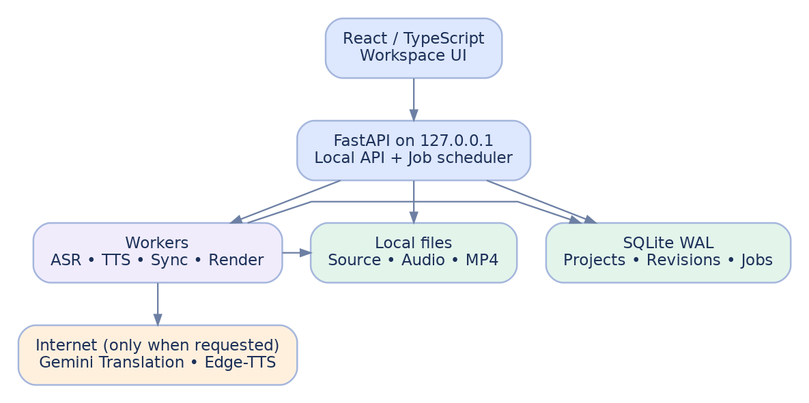
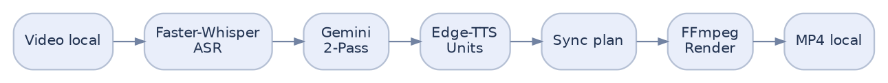

# Hồ sơ thiết kế dự án AutoDub Local vNext

**Trạng thái:** Đặc tả cho dự án mới — chưa triển khai mã nguồn, chưa kiểm thử, chưa nghiệm thu.  
**Mục tiêu:** Webapp chạy trên Windows, cho phép người dùng cấu hình từng giai đoạn lồng tiếng video; video, bản dịch, audio, bản render và dữ liệu dự án đều nằm trên máy. Không sử dụng Supabase. Gemini và Edge-TTS cần Internet.

## 1. Quyết định kiến trúc

AutoDub Local vNext được xây lại từ một repository mới. Mã nguồn `video-dubbing-automation.zip` là tài liệu tham khảo nhằm kế thừa thuật toán Faster-Whisper, Gemini, Edge-TTS, FFmpeg; không nhập lại nguyên ứng dụng cũ hay sao chép `.env`, model/binary và dữ liệu người dùng. Giao diện React/TypeScript + Vite; backend FastAPI/Python; dữ liệu quan hệ SQLite WAL; video, phụ đề, WAV/MP3 và MP4 lưu trong thư mục Windows do người dùng chọn.

## 2. Vòng đời Project

Người dùng tạo Project, chọn video và thư mục lưu trữ, chọn ASR model/ngôn ngữ/thiết bị, kiểm tra đoạn nhận diện, dịch hai lượt bằng Gemini, sửa bản dịch hàng loạt, chọn giọng/tốc độ Edge-TTS, tạo và nghe từng Unit đã sẵn sàng, xem bảng xung đột thời gian, tùy chỉnh âm nguồn/giọng đọc/phụ đề/codec rồi xuất MP4. Các bước có kết quả và phiên bản riêng; sửa một Unit không được mặc nhiên tạo lại toàn bộ video.

## 3. Phân tách MVP — V1 — V2

| Cấp độ | Nội dung chính | Không yêu cầu ở cấp này |
|---|---|---|
| MVP — Core Dubbing | Local Project + SQLite/Job tối thiểu, ASR, Gemini và bulk edit, Edge-TTS nghe từng đoạn, bảng Sync số, FFmpeg MP4 xác minh | Không Timeline nhiều track, không video stretch, không Backup/Restore đầy đủ |
| V1 — Quality & Reliability | Vocal Separation tùy chọn, Backup/Restore checksum, Job recovery/batch nâng cao, profiling | Không bắt buộc timeline kéo thả |
| V2 — Advanced Editing | Multitrack waveform/timeline và Video Stretch có phép ánh xạ thời gian thống nhất | Không được triển khai khi engine Sync cơ bản chưa ổn định |

MVP vẫn bắt buộc ghi file an toàn, bảo toàn sửa đổi của người dùng và nhận biết Job bị ngắt. Điều được hoãn là kiến trúc lease/heartbeat phân tán và backup di động đầy đủ — không phải tính đúng đắn dữ liệu cơ bản.

## 4. Công nghệ và phần cứng

| Hạng mục | Lựa chọn | Chú ý |
|---|---|---|
| Frontend | React, TypeScript, Vite | Giao diện desktop-first; cấu hình từng bước |
| Backend | FastAPI, Pydantic, Python | Chạy loopback `127.0.0.1` |
| Data | SQLite WAL + filesystem | Migrations, FK và file atomic publish |
| ASR | Faster-Whisper + FFmpeg | Tự kiểm tra NVIDIA CUDA/VRAM; CPU fallback |
| Translation | Gemini 2 lượt / google-genai | Chỉ gửi transcript cần dịch, có quota/retry |
| TTS | Edge-TTS | Phụ thuộc Internet; retry có giới hạn, không giả audio lỗi thành im lặng |
| Video | FFmpeg / FFprobe | NVENC khi thực sự hỗ trợ, CPU fallback và kiểm tra output |
| V1 separation | Mô hình tách giọng sẽ được lựa chọn sau đo kiểm | Demucs chỉ là ứng viên, không hứa tách hoàn hảo |

Khai thác tối đa phần cứng nghĩa là chọn cách chạy nhanh nhất *được chứng minh* trên máy thực, không phải bật tất cả Worker đồng thời. GPU dành ưu tiên cho Faster-Whisper và render nếu tương thích; TTS Edge qua mạng được giới hạn concurrency. Cần giám sát CPU, RAM, VRAM, I/O và tránh khiến Windows thiếu tài nguyên.

## 5. Cơ chế dữ liệu và lỗi

Metadata Project, Segment, Translation Unit, TTS Artifact, Run, Job và trạng thái lưu bằng SQLite. Video nguồn và thành phẩm được giữ; file tạm chỉ xóa khi có thể xác nhận không còn cần thiết. Artifact có fingerprint từ dữ liệu đầu vào, cấu hình và phiên bản provider để chạy lại có chọn lọc. Khi máy tắt giữa chừng, chỉ kiểm tra và khôi phục trạng thái an toàn, không đánh dấu READY nếu file chưa được đo/kiểm chứng.

## 6. Thuật toán AV-Sync trong MVP

Đo thời lượng audio thật sau Edge-TTS. Mỗi Unit có mốc nguồn, vị trí dự kiến, độ dài audio và mức chênh. Bảng Sync hiển thị các Unit xung đột; cho người dùng sửa lời thoại, chọn tốc độ giọng trong giới hạn, hoặc dịch vị trí vào khoảng trống hợp lệ. Giữ nguyên thời lượng video nguồn. Không tự cắt mất audio, không tự giãn hình hay ẩn xung đột. FFmpeg lấy SyncPlan đã xác minh để trộn và xuất file; FFprobe đo lại video thực.

## 7. Audio gốc và Vocal Separation

MVP cho phép tắt âm nguồn, giảm âm hoặc ducking khi TTS đang nói, nhưng điều này cũng làm giảm nhạc và hiệu ứng chung với lời thoại. Tại V1 sẽ nghiên cứu bộ tách giọng nguồn tùy chọn như Demucs hoặc model phù hợp hơn. Phải thử với video có lời thoại/nhạc/SFX, đo tiếng còn sót, biến dạng âm, VRAM và thời gian thực thi. Không mặc định bật, không hứa chất lượng tuyệt đối.

## 8. Video Stretch và Timeline ở V2

Trình kéo thả nhiều track không nằm trong MVP. V2 mới xây dựng timeline trực quan và Video Stretch; mọi đoạn video, âm thanh nguồn, TTS và phụ đề phải dùng cùng phép ánh xạ thời gian nguồn → đầu ra. Kiểm thử phải chứng minh không trôi đồng bộ trên video VFR, thoại chồng lấn và thời lượng dài.

## 9. Các giai đoạn thực hiện

| Giai đoạn | Đầu ra | Điểm nghiệm thu |
|---|---|---|
| ARCH-00 | Contract và repository skeleton | G0 — phạm vi được chốt |
| CORE-01 | SQLite, Local API, Job đơn giản | G1 — lưu dữ liệu/khôi phục cơ bản |
| MEDIA-01 | Thư viện, chọn video và thư mục | G2 — media local chạy đúng |
| ASR-01 | Transcript có timestamp và sửa được | G3 — kiểm thử video thực |
| TRANS-01 | Gemini 2 Pass, lưu sửa hàng loạt | G4 — mapping và revision đúng |
| TTS-01 | Edge-TTS, Unit nghe ngay khi xong | G5 — lỗi/retry/cache đúng |
| SYNC-01 | Bảng đồng bộ số, phát hiện xung đột | G6 — không ẩn lệch tiếng |
| RENDER-01 | MP4 local đã qua FFprobe | G7 — xem/phát hợp lệ |
| MVP-QA-01 | Kiểm thử toàn luồng | G8 — người dùng xác nhận |
| V1/V2 | Chất lượng, backup, timeline, retime | Không cản MVP |

## 10. Đánh giá kế thừa và rủi ro

Có thể kế thừa ý tưởng cấu hình ASR, tách media/FFmpeg, prompt Gemini, Edge-TTS và các phương án encode từ mã nguồn cũ nhưng phải viết lại theo interface rõ, bổ sung test. Không được kế thừa cách cắt bỏ nội dung dài, thay audio TTS lỗi bằng im lặng, hoặc render không kiểm tra thời lượng. Hai nhà cung cấp Gemini/Edge-TTS có thể thay đổi hành vi và hạn mức; phần cứng NVIDIA/NVENC cần đo thực tế.

## 11. Điều kiện hoàn tất tài liệu

Bộ hồ sơ này là kế hoạch. Mọi chức năng trong bảng đều **chưa triển khai**. Các giai đoạn chỉ được đánh dấu hoàn thành khi code chạy, test ghi bằng chứng và người dùng nghiệm thu. Tài liệu chi tiết gồm `PROJECT_BLUEPRINT.md` cùng `docs/01_*` đến `docs/14_*` và `PLAN.md`, `TASK.md`, `RULES.md`.
