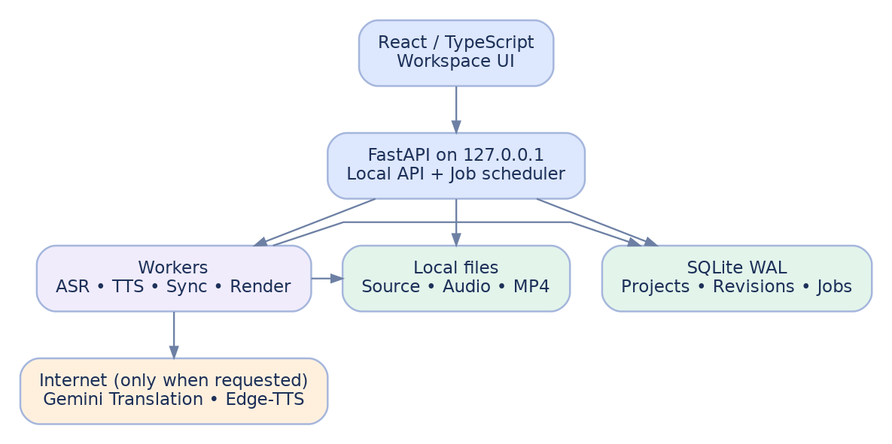
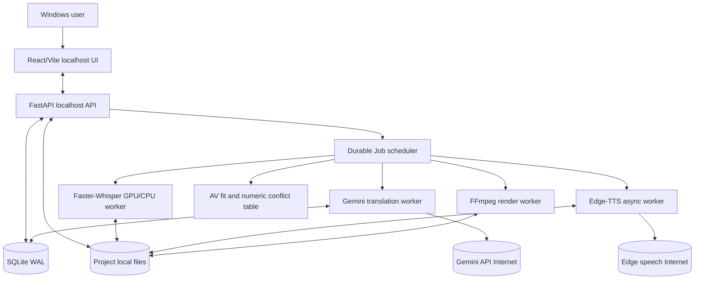
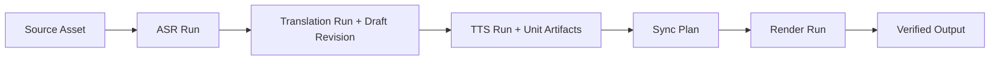
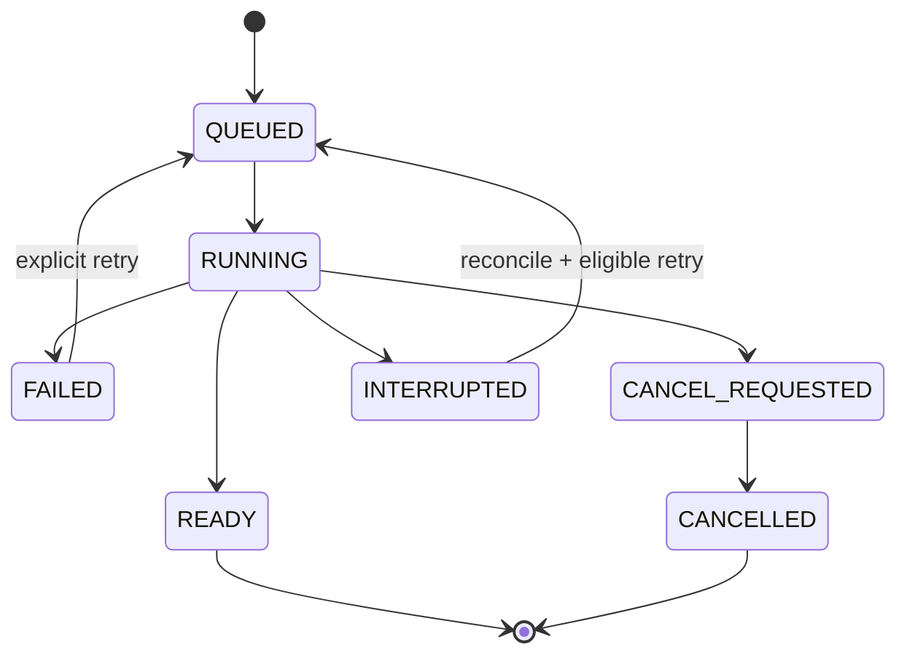

# Consolidated Technical Blueprint

**Status:** Design only, no executable implementation or owner acceptance. **Scope authority:** `docs/14_SCOPE_BASELINE.md`. The MVP has a numeric sync table and fixed source-video duration. Optional Vocal Separation + backup in V1, multitrack timeline + video stretch in V2.




---

# 01 — Product Requirements (PRD)

**Status:** Proposed design, not implemented. **Owner:** Windows solo video creator/editor. **Interface:** Vietnamese. **Canonical scope:** `docs/14_SCOPE_BASELINE.md`.

## Product goal

Provide a configurable local-only dubbing webapp: select video/paths → ASR → inspect/correct → Gemini contextual translation → bulk edit → Edge-TTS voice/speed and per-Unit playback → conflict-aware numeric sync → FFmpeg/FFprobe MP4. A user can pause, review, adjust and rerun only affected stages. All media and structured work data stay on the user's disk.

## Product principles

- Fast iterative feedback and **no external media upload**; only Gemini and Edge-TTS need Internet.
- The user chooses storage, ASR model/device/language, translation style, voice/rate, sync overrides and render configuration.
- Never silently truncate text, replace missing speech with silence, mutate original media, or claim a Stage passed without evidence.
- Immutable, measured artifacts with input/config fingerprints. Preserve saved edits and verified output.
- First reach an accepted complete MP4, then add advanced quality/editing features.

## Scope matrix

| ID | Capability | Release | Acceptance example |
|---|---|---|---|
| F01 | Project Library, video import/copy/link, paths, local source playback | MVP | Opens after restart, no cloud upload |
| F02 | FFprobe metadata, orientation, source seek and safe deletion | MVP | Portrait/landscape/Unicode source works |
| F03 | ASR language/model/VAD/GPU-or-CPU controls and correction review | MVP | Real transcript with stable timestamps |
| F04 | Gemini two-pass translation, context/glossary and complete mappings | MVP | Missing source ID detected |
| F05 | Side-by-side translation bulk editor, save/correction history | MVP | Edited content survives restart |
| F06 | Edge-TTS voice/rate/preview, per-Unit retries and valid playable audio | MVP | First Unit playable while others generate |
| F07 | Selective regeneration using verified per-Unit fingerprints | MVP | One edit doesn't rerun unrelated units |
| F08 | Simple sync table with measured duration/offset/gap/conflicts | MVP | Overlap shown, video duration unchanged |
| F09 | Configurable original mute/gain/ducking + voice/subtitle render | MVP | FFprobe-verified MP4 |
| F10 | SQLite minimal durable Job state, cancellation and safe restart | MVP | No false READY after interruption |
| F11 | Optional short-range render preview | MVP after first working full render | No changes to final file |
| F12 | Optional Vocal Separation and audio quality comparison | V1 | Real vocal/music test with documented artifacts |
| F13 | Portable checksum-based backup/restore and richer Job recovery | V1 | Restore to another folder verified |
| F14 | Batch queue and advanced resource scheduling | V1 | One failed Project does not kill others |
| F15 | Multitrack drag/drop timeline and waveform | V2 | Smooth large-track interaction |
| F16 | Local video stretch and cross-track canonical retime | V2 | No cumulative A/V/subtitle drift |

## MVP out of scope

No Supabase, account login, remote media upload/sync, full DAW-style timeline, automatic video stretching, guaranteed source-vocal isolation, complex distributed heartbeat/lease infrastructure, or mandatory full Project backup. Basic integrity/crash safety is still required.

## User journey

1. Create a local Project and select video, target folder/output folder, Copy/Link mode.
2. Inspect FFprobe metadata; select ASR model/language/device/VAD and run.
3. Review/edit transcript against source seek controls.
4. Translate with Gemini, inspect Pass1/Pass2 outputs and bulk-edit final Vietnamese text.
5. Choose Edge voice/rate, preview, synthesize per Unit; listen to finished Unit immediately and correct/retry selected Unit.
6. Review timing conflict **table** with fixed original video timeline; adjust rate/text/start/gap within safe bounds.
7. Configure source sound mix, subtitles, codec/resolution and output path; render and verify MP4.
8. Close/reopen Project and confirm edits and verified artifacts remain intact.

## Release success measures

- End-to-end original video → Vietnamese MP4 completed with actual quality review.
- Audio playable per Unit before all units finish; invalid/missing Units never reported READY.
- No data loss for accepted edits/verified files after ordinary restart.
- Measured time-to-first-audio and encode performance reported; no fabricated 'maximum GPU' claims.
- CPU fallback explicit if GPU unavailable; basic UX functional on one Windows machine.

## Future quality criteria

V1 can add optional separation where demonstrably useful; it may fail on some videos and must be bypassable. V2 may retime video only after a single piecewise source→output time transform is applied to all tracks and tested on VFR/overlap/long duration media.


---

# 02 — System Architecture & Technology Choices

> **Phase rule:** `14_SCOPE_BASELINE.md` defines mandatory MVP vs V1/V2 scope; advanced designs in this document do not imply MVP implementation.

**Status:** Target design, not an implemented codebase.

## 1. Context diagram



## 2. Top-level components

| Layer | Target technology | Responsibility | Rationale |
|---|---|---|---|
| Presentation | React 19 / TypeScript / Vite, router, TanStack Query or equivalent | Project Library, editors, controls, progress | Better rich interaction than legacy Streamlit full reruns |
| Local API | Python 3.11 **candidate**, FastAPI/Pydantic v2 | Typed HTTP endpoints, range media streaming, input validation | Mature async API and Python media ecosystem |
| Work coordinator | Separate Python worker processes, SQLite job tables | Minimal single-host durable status, progress, cancel/retry/recover in MVP; advanced lease/heartbeat only V1 if needed | Heavy inference isolated from HTTP thread |
| Persistent metadata | SQLite WAL, schema migrations via Alembic or explicit SQL | Project, Run, Unit, artifact, Job, edit revisions | Single-user local persistence, transactional updates |
| Media | FFmpeg/FFprobe CLI, `soundfile`, optional `PyAV` | Decode/extract, combine, measure, render | Avoid handling full video frames in Python |
| ASR | Faster-Whisper / CTranslate2 | Speech segments with start/end | GPU float16 or CPU int8 fallback |
| Translation | `google-genai` SDK | Gemini two-pass, structured JSON | Maintained SDK, explicit quota failures |
| Speech | `edge-tts` as default adapter | Vietnamese voice TTS, MP3/format metadata | Match legacy user preference; requires internet |
| Voice preview | Bounded file cache | Short sample by exact voice/rate/pitch/config | Avoid repeated network generation |
| Subtitle OCR (optional) | OpenCV + EasyOCR/other measured implementation | Suggest old subtitle location | Costly stage, opt-in, verify visually |
| Hardware probe | OS queries, `nvidia-smi` when present, FFmpeg capability enumeration | Choose safe profile | Actual supported hardware rather than assumptions |
| Packaging | `run.cmd` for development, future frozen installer | One-click Windows launcher | Avoid uncontrolled services |

**Version rule:** The versions above are candidates or families; resolve exact compatible pins with a clean environment during ARCH-00. Faster-Whisper/CTranslate2 GPU dependency requires testing against actual CUDA/cuDNN/driver. No claim that a user NVIDIA GPU exists.

## 3. Directory structure — proposed source repository

```text
AutoDub-Local/
├── README.md  AGENTS.md  RULES.md  PLAN.md  TASK.md
├── CHANGELOG.md  UPDATES.md  ERROR_LOG.md
├── .env.example  .gitignore  run.cmd
├── frontend/
│   ├── package.json  src/
│   ├── src/app/  src/pages/  src/components/
│   ├── src/features/projects/
│   ├── src/features/asr/
│   ├── src/features/translations/
│   ├── src/features/tts/
│   ├── src/features/sync-table/  # MVP; full timeline deferred to V2
│   ├── src/features/render/
│   └── src/api/  src/types/
├── backend/
│   ├── pyproject.toml  requirements.lock
│   ├── app/main.py
│   ├── app/api/routes/
│   ├── app/core/config.py  app/core/hardware.py
│   ├── app/domain/{project,segment,translation,artifact,job}.py
│   ├── app/repositories/{project,unit,job,artifact}.py
│   ├── app/storage/{paths,media,backup}.py
│   ├── app/services/{asr,translation,tts,sync,render}/
│   ├── app/providers/tts/{base,edge}.py
│   ├── app/workers/{runner,asr,translation,tts,render}.py
│   ├── app/db/migrations/
│   └── tests/{unit,integration,fixtures}/
├── scripts/{launcher,diagnostics,benchmarks}/
└── docs/
```

`data_root` is *outside the source repo*. Never ship media, API keys, AI models, venv or cached WAV in Git.

## 4. Processing boundary / no oversized pipeline controller

Each stage consumes immutable snapshots and emits verified artifacts. Orchestration does **not** call every stage within one HTTP request. API schedules a durable Job and returns `202` + Job ID. A worker reports progress. UI polls or uses SSE/WebSocket; polling is acceptable for MVP. Each result can be edited, accepted and rerun independently.



Edits invalidate only descendants whose *actual input fingerprint* changes. Example: correcting a source Segment invalidates dependent translation units; a translation edit invalidates dependent TTS units and sync/render. Changing subtitle color invalidates render only.

## 5. Eventing & ownership

- API owns business validation and local user actions; worker owns long job and artifact publication.
- Only one active high-VRAM ASR/OCR job by default; renderer may be GPU-exclusive depending on device budget; Edge TTS is network-bound with bounded concurrency.
- MVP uses a single-machine owner/supervisor, persisted JobAttempt and safe startup reconciliation; lease/heartbeat is an optional V1 enhancement if validated multi-worker requirements emerge.
- UI never infers Job success from existence of an `.mp3` file alone. Database READY is published after FFprobe/decoder verification and integrity checks.

## 6. Storage-independent provider contracts

- `SpeechProvider.list_voices()`, `preview(config)`, `synthesize(unit_id, text, config, output_path, cancel_token)` returns validated artifact metadata.
- `TranslationProvider.translate(groups, context, config)` returns schema-validated mappings with token usage and model/version.
- `MediaProbe.probe(path)` returns stable technical metadata; `RenderEngine.render(plan)` returns verified manifest.
- Never pass secrets into frontend; API may return *capability descriptions*, not credentials.

## 7. Hardware truthfulness

- `h264_nvenc` uses GPU encoder; CPU-based `subtitles`/`libass` filter may require `hwdownload`/`hwupload`, so not every step is on GPU.
- CUDA decode and GPU scaling only when the exact FFmpeg build/filter chain permits it; GPU–CPU transfers may slow things down.
- Faster-Whisper GPU float16 often faster, but on low VRAM the CPU path can be more reliable. Benchmark on target PC, record config.

## 8. Trust boundaries

Local UI on `127.0.0.1`, backend on `127.0.0.1`, Windows filesystem trusted only after user selection, external Gemini/Edge endpoints separate. Validate files based on probing, not extension alone. Rate-limit local endpoints and ensure no remote web page can invoke destructive local APIs through weak CORS/CSRF protections.


---

# 03 — SQLite Data Model, Local Storage, Revision & Backup

> **Phase rule:** `14_SCOPE_BASELINE.md` defines mandatory MVP vs V1/V2 scope; advanced designs in this document do not imply MVP implementation.

## 1. Goals

Maintain user edits and processing artifacts across application restarts, crashes and selective reruns, with no Supabase. Never discard accepted data when regenerating. SQLite handles small structured records; large media is stored as local files.

## 2. Tables (logical schema)

| Table | Core columns / invariant |
|---|---|
| `projects` | `id UUID PK`, `name`, `status`, `created_at`, `updated_at`, `active_source_asset_id`, `active_transcription_run_id`, `active_translation_revision_id`, `active_tts_run_id`, `active_sync_plan_id`, `active_render_id` |
| `media_assets` | `id`, `project_id`, `role SOURCE/OUTPUT/PREVIEW`, `import_mode COPY/LINK`, `relative_path` or approved external path, `size`, `sha256`, duration_us, streams JSON, verified_at |
| `transcription_runs` | `id`, `project_id`, `source_asset_id`, model/device/language/VAD config JSON, immutable provenance, status |
| `segments` | `id`, `run_id`, position, start_us, end_us, source_text, confidence/flags; unique(run_id,position), start < end |
| `translation_runs` | `id`, `transcription_run_id`, provider/model/config, structured result metadata |
| `translation_units` | `id`, `run_id`, ordered index, start_us/end_us, `source_segment_ids`, proposed_text, final_text, revision, status |
| `translation_edits` | `id`, `unit_id`, old/new text, revision, author=local, timestamp, optional reason |
| `tts_runs` | `id`, `translation_run_id`, provider, voice/rate settings snapshot, status |
| `tts_artifacts` | `id`, `run_id`, `unit_id`, fingerprint, provider/voice/rate, relative audio path, format, duration_us, sample_count, sha256, verified_at, status |
| `sync_plans` | `id`, `tts_run_id`, policy/config, resolved timeline JSON, conflicts JSON, status, sha256 |
| `render_runs` | `id`, `sync_plan_id`, profile, filtergraph path, output_asset_id, ffprobe report, status |
| `jobs` / `job_attempts` | kind, project, input fingerprint, status, attempts, local_process_owner (V1 may add heartbeat/lease), stage, started/ended, error_code |
| `project_settings` / `app_settings` | typed JSON config with schema version, per-run snapshots; secrets stored separately |
| `artifact_dependencies` | parent fingerprint, child ID; for invalidation and incremental reruns |
| `backup_manifests` | ID, project, created_at, file inventory, content sha256, schema version, completeness |

Relationships: one Project -> multiple source/video Runs -> many Segments/Translation Units/TTS artifacts -> immutable sync plan -> render. Existing Run rows never silently overwrite; active pointers move transactionally after validation.

## 3. Example invariants

- `end_us > start_us >= 0`, `position >= 0`, foreign keys valid. Any overlap is represented and reviewed, not silently collapsed.
- `source_segment_ids` for a Translation Unit is non-empty, ordered, refers to same ASR Run, and the set of active source IDs is completely covered exactly as chosen mapping strategy requires.
- `final_text` edit increments revision by compare-and-swap: `UPDATE ... WHERE id=? AND revision=?`, reject 0 rows as conflict.
- `tts_artifact` READY only if target file exists, decodes, nonzero speech where text nonempty, size/hash/duration match DB.
- `render_run` READY only if MP4 exists, playable streams present, reported duration within accepted tolerance, output checksum computed.

## 4. Local path scheme

```text
<User-chosen DataRoot>/
  app.db
  projects/<project_uuid>/
    source/<asset_id>.<ext>
    asr/<run_id>/transcript.json
    translations/<run_id>/snapshot.json
    tts/<run_id>/<unit_id>.<ext>
    sync/<plan_id>/plan.json
    render/<render_id>/preview.mp4
    render/<render_id>/output.mp4
    logs/<job_id>.jsonl
  cache/models/<model_id>/
  cache/preview_tts/<fingerprint>.mp3
  scratch/<job_id>/
  backups/
```

Project source **COPY**: adopt file by streamed copy and probe; source retained in managed project dir. **LINK**: store owner-approved absolute path and fingerprint; show missing status if moved; do not delete linked file even when deleting Project. A `data_root` outside source repo is mandatory. Output export may copy from managed `render/<id>` to a user-selected output folder; record both paths.

## 5. Atomic artifact publication

1. Worker creates `scratch/<job_id>/candidate.<ext>`.
2. Write/flush/close file; independent validation (`ffprobe`, media duration, format, non-silence where required), checksum.
3. Move candidate to immutable `projects/<id>/<kind>/<run_id>/...` within same filesystem when possible.
4. Database transaction adds immutable artifact, updates Job stage/active pointer if input versions still match; commit.
5. Recovery reconciles orphan files/DB rows after crash. Never publish an incomplete artifact.

For cross-volume destination, copy+verify to temp at final volume then atomic rename. Source stays until successful verification.

## 6. SQLite operational policy

- `PRAGMA foreign_keys=ON`; WAL on local SSD/NVMe, `busy_timeout` configured; each process opens its own connection; no shared cross-process connection object.
- Avoid long transactions holding write lock while running inference/network I/O. Claim/update quickly; inference outside transaction.
- For MVP job claiming, acquire a short write transaction (`BEGIN IMMEDIATE`), select eligible work, mark running and create an attempt atomically under one local worker owner. Lease/heartbeat may be added in V1 if multi-worker contention requires it.
- Migrations strictly versioned, backed up before destructive schema changes; no network mounted SQLite WAL file.
- On application close/backup, use SQLite online backup API, ensure consistency of associated files using manifest.

## 7. Version/fingerprint strategy

`fingerprint = SHA256(canonical_json({input_ids+hashes, relevant_config, tool_id, model_version, normalization_version}))`.

Sample invalidations:

| Change | Reuse | Invalidate |
|---|---|---|
| Subtitle font/color | ASR, Translation, TTS, Sync | Render only |
| Voice/rate on Unit 4 | Other Unit TTS artifacts | Unit 4 TTS, Sync, Render |
| Edit Translation Unit 4 | ASR and other Units | Unit 4 TTS + downstream |
| Change ASR model | Source video | New ASR and dependent stages; preserve old Runs |
| Change output path | All processing results | Export file copy only |
| Change background audio mix | ASR/Translation/TTS | Render plan/output |

## 8. Backup/restore — V1 (not a mandatory MVP feature)

- `.autodubpack` (ZIP or folder bundle) includes consistent SQLite project export, source (or references and missing warning), translations, verified TTS, selected render(s), SHA-256 manifest and version metadata.
- If backing up linked external source, prompt Copy-into-backup vs references-only; warn when not portable.
- Restore to staging, verify checksums/schema, resolve ID/path collisions, transactionally activate; never overwrite an existing Project silently.
- When V1 backup is implemented, it must be tested with reopen/play/edit/render on fresh destination. MVP already needs atomic writes and safe startup recovery. No destructive auto-cleanup of original or final results.

## 9. Storage policy

App can report reclaimable `scratch`, previews, obsolete model downloads (with approval), and orphaned failed artifacts. **Never default-delete** source video, final MP4, accepted revision history or currently referenced verified TTS. Old intermediate Runs are only removable through an explicit impact preview and dependency graph.


---

# 04 — Pipeline Algorithms, Validation & Incremental Processing

> **Phase rule:** `14_SCOPE_BASELINE.md` defines mandatory MVP vs V1/V2 scope; advanced designs in this document do not imply MVP implementation.

**Rule:** Time represented as integer microseconds (`*_us`) for timeline operations; audio sample/frame counts where possible. Floats only at API boundaries and diagnostic displays. Algorithms below are design targets; none are runtime-verified in the new app.

## 1. Source intake and media probing

```text
Choose source -> explicit Copy or Link -> file type/size/safety check
-> FFprobe streams/duration/frame rate/aspect/rotation/audio
-> SHA-256 fingerprint + Project source asset -> READY
```

For copied source: stream in chunks to local temp, fsync where needed, checksum and atomic publish. For linked source: never modify source; relink if missing; hash on demand with progress for large files. Show whether frame rate is VFR; do not round source fps to two decimals blindly. Estimate required disk space before extraction/render.

## 2. ASR — speech to stable Segments

**Inputs:** verified source, source language, ASR model, beam, VAD config, prompt/vocabulary, device profile.  
**Algorithm:**

1. FFmpeg extracts mono 16 kHz PCM/resamples accurately (`-vn -ac 1 -ar 16000`), or stream decode with bounded memory.
2. Probe GPU; choose Faster-Whisper/CTranslate2 device and compute type. Warm model inside Worker; on genuine CUDA error, log classification and retry once on CPU if allowed.
3. Run VAD if selected, use timestamps relative to original audio; map segment times to original media PTS, not simply contiguous VAD chunks.
4. Transcribe with bounded worker; iterate generator fully; validate ordered segments and finite timestamps. Store model/device/latency.
5. Detect likely hallucination (long repeated patterns, low/no speech, compression anomalies) as `REVIEW_REQUIRED`; **do not erase text silently**.
6. Save immutable ASR Run; user may edit transcript using draft layer; accepted run ID remains unchanged.

**Important:** Legacy `_GLOBAL_WHISPER_MODEL` is a useful cache concept but must be adapted to a supervised process, not a module-global variable inside UI. Device/beam/batch must be benchmarked against VRAM.

## 3. Segment normalization and translation grouping

Goal: maintain accurate source mapping while translating natural thoughts, not every tiny ASR fragment in isolation.

- Sort by `start_us`, `position`, stable ID; reject invalid time spans.
- Build candidate groups based on sentence boundaries, punctuation, gap <= configured threshold, topic continuity and max group duration/characters; grouping is explicitly configurable.
- The user can merge/split within limits, and each group stores `source_segment_ids` and temporal envelope.
- **Coverage invariant:** every included source segment maps to exactly one output group or is explicitly marked SKIPPED with reason; no lost IDs.
- Do not hard-code `3 segments max` unless benchmark and product requirements justify it; preserve a guard against unbounded groups.

Pseudocode:

```python
for source in verified_segments:
    assert source.end_us > source.start_us
    if can_append(group, source, gap_limit_us, duration_limit_us, text_limit):
        group.append(source)
    else:
        flush(group); group = [source]
flush(group)
assert covered_source_ids(groups) == expected_ids
```

Grouping is translation input management, not a guarantee of natural semantics. User review stays available.

## 4. Gemini two-pass translation

**Pass 1 (context):** Translate grouped source into Vietnamese with whole-video summary/context, genre/glossary, pronoun consistency, stable IDs. Return schema-validated JSON. Preserve numbers/names/negation; no automatic "creative" insertion.

**Pass 2 (dubbing optimization):** Rewrite Pass 1 for natural spoken Vietnamese and target duration; preserve meaning, source IDs, named entities, pronunciation hints. Avoid padding words/automatic terminal periods that are not needed. Return exact schema.

**Long input:** token-estimate -> context windows with overlap and carried glossary/summary -> output segments -> reconcile; never drop groups exceeding context. Pass 2 runs per bounded chunk after Pass 1 validated. Retry bounded transient errors only; quota exhausted returns `WAITING_FOR_QUOTA`, not fake success.

**Validation:** exact ID set, no extra IDs, no missing/empty output unless explicitly approved, no impossible timestamps, Unicode valid, no invalid content type, drift/character ratio warnings, protected manual revision compare-and-swap. Do not use regex greedily to extract arbitrary JSON as trust boundary; prefer structured generation where available and strict parser.

**Edit UI:** source original, Pass 1, Pass 2, final text; Save All; role/style glossary; regenerate selected only; editorial approval needed for missing translations.

## 5. Edge-TTS — per-Unit synthesis

**Inputs:** accepted translation revision, chosen voice (default `vi-VN-NamMinhNeural` from legacy), rate%, pitch/volume if supported, output format, provider version. Edge-TTS requires Internet and is not under the same local CPU/GPU performance optimization as ASR/FFmpeg.

1. Compute artifact key from `unit_id + text hash + voice + rate/pitch/volume + provider/version + synthesis version`.
2. Reuse valid matching cached artifact. If not, create TTS Job for that Unit; use bounded async semaphore (start 2-3, tune based on real error/network data, not automatically 5).
3. Sanitize only unsupported control characters. **Never shorten, truncate or rewrite the user's accepted text** behind their back.
4. If Edge length/format limit is encountered, split by sentence/word boundaries into all subchunks with retained exact concatenated text and source mapping; synthesize all; concatenate with measured pauses. If impossible, return REVIEW_REQUIRED.
5. Download to temp file, verify codec/duration, decode sample, inspect non-silence when non-empty text, sha256 and atomic publish; mark Unit READY independently.
6. Retry transient network/429/5xx with jitter and caps; fail with a clear error when attempts exhausted. No silent WAV substitution for failed speech.
7. Expose voice preview cache with exact config, asynchronous cancellation, bounded memory/disk.
8. A Unit can be played while other Units generate. TTS Run READY only after all required Units READY and still matching latest revision.

**Rate fitting:** optional `target_rate = clamp(base_rate * (measured_duration / target_window), allowed_min, allowed_max)` is only a first estimate. Rate/duration can be nonlinear; verify after synthesis, maybe one bounded adjustment, never infinite retries. Explain remaining overflow to user.

## 6. Incremental invalidation

For any changed Unit:

```text
new Unit revision -> compute input fingerprint
same fingerprint + existing verified artifact? reuse
otherwise queue only affected Unit -> produce new artifact
then rebuild sync plan (cheap) -> invalidate render output only
```

Changes in voice/rate globally affect all Units by design; per-Unit overrides only affect selected Units. No delete-before-replace; old artifacts remain referenced until a new Run is explicitly accepted.

## 7. AV synchronization constraints

Define each Unit `i`: source window `[s_i, e_i)`, speech duration `d_i`, selected audio-rate `r_i`, start shift `Δ_i`, V2-only optional local video stretch `v_i`; target window `w_i = e_i - s_i`.  
`overflow_i = max(0, d_i - w_i - allowed_tail_i)`.

Possible responses in preference order selected by user:

1. **Rewrite text** (back to Translation, with review) if meaning can be preserved.
2. **Adjust Edge rate** within user allowed range and remeasure.
3. **Use gaps/shift start** if no conflict with adjacent speech and within timing tolerance.
4. **V2 only — Local video retime** bounded (requires rebuilding video/audio/subtitle timeline; excluded from MVP and cannot be proposed by MVP planner).
5. **Manual accept overlap/overflow** with visually explicit warnings, never silently treat as valid.

A default optimization can solve weighted objective:

`MVP: min Σ_i [ λ1 * max(0, overflow_i)^2 + λ2 * (r_i - r_base)^2 + λ3 * (Δ_i)^2 ]` (V2 adds a separately validated video-retime penalty)

subject to `r_min <= r_i <= r_max`, monotonic source event order and no unapproved overlap (V2 only: add bounded total video stretch). The optimizer generates a plan **without producing audio/video changes**. The UI displays candidate settings and conflict reasons; user approves before full render.

Caveat: if source has overlapping speakers, monophonic voiceover policy cannot always satisfy all spans. Flag rather than forge impossible timing.

## 8. Audio compositing and mixing

- Decode each TTS artifact to common sample rate/format only for the final mix; position at rounded sample index from plan `round(t_us * sample_rate / 1e6)`.
- Apply equal-power or selected gain crossfade on overlapping clips; detect peaks/clipping and loudness, use limiting if enabled.
- Original audio mix options: mute original dialogue, mix original audio at configurable gain, duck original around synthesized speech using sidechain if selected.
- MVP uses mute/gain/ducking; preserve ambience where possible but note that voice and music are mixed together. V1 may add **optional** model-based Vocal Separation after real listening/hardware evaluation; do not claim perfect separation.
- Render intermediate `voice_mix.wav` with origin metadata and sample count; compare predicted vs measured duration.

## 9. Subtitle generation

- Render separate `.ass` with `PlayRes`, font/size/outline/background/position and exactly chosen timeline. Escape ASS syntax and Unicode correctly.
- UI offers subtitle toggle, placement, color, font, margins and optional OCR suggestion to avoid overlaying existing subtitle areas.
- OCR outputs are suggestions, with bounding boxes and preview; never automatically obscure important visual content.

## 10. Render and validate

1. Build immutable `RenderPlan` containing source hash, Sync Plan fingerprint, subtitle style, audio gains, video filter list, output codec/quality and paths.
2. Probe capabilities. Use no forced GPU path. Determine a compatible filter chain; if CPU subtitle filter is required, account for frame transfer.
3. Use FFmpeg arguments built as an argv list; long filter graph stored in `-filter_complex_script` file (legacy WinError 206 insight).
4. Render short range preview first on demand; full render in scratch, parse `-progress pipe:1` for real progress.
5. On encoder failure, controlled fallback only if user allows; report actual codec and hardware path used; do not hide quality change.
6. FFprobe output; validate video/audio stream, duration/rate/rotation, expected subtitle/audio, nonzero payload and checksum. Publish to chosen output folder atomically (cross-volume copy+verify if necessary).
7. Render failure leaves previous verified MP4 intact and an actionable log.

## 11. Inference/performance telemetry

Every stage writes elapsed times and resources: decode, model warm-up, inference, network wait, synth, disk, mix, encode, verify. No actual video transcript text or secrets in logs by default. Benchmark results separate cold/warm starts and Auto/Balanced/Fast profiles.


---

# 05 — Hardware Utilization & Performance Strategy

> **Phase rule:** `14_SCOPE_BASELINE.md` defines mandatory MVP vs V1/V2 scope; advanced designs in this document do not imply MVP implementation.

**Goal:** Use available hardware efficiently without resource exhaustion, driver conflicts or falsely claiming that every step is GPU accelerated. **Hardware of the owner's PC has not been supplied**, so values below are **tunable policies**, not confirmed settings.

## 1. Hardware probe on first launch and Settings

Collect safely:

- CPU name/logical/physical cores, memory available, disk filesystem and free bytes, SSD/NVMe if observable.
- NVIDIA GPU name, VRAM total/free, driver, compute capability / CUDA runtime if `nvidia-smi` and dependency probe succeed.
- Faster-Whisper/CTranslate2 GPU initialization smoke test with an appropriately tiny model (opt-in if costly), distinguish CUDA DLL unavailable vs out-of-memory.
- FFmpeg build, decoders, `h264_nvenc`/`hevc_nvenc`/`av1_nvenc` (if supported), `libx264`, `subtitles/libass`, `scale_cuda`/`scale_npp`; actual micro encode/decode test.
- Network reachability for Gemini/Edge separately, without leaking credentials.

**Display:** `Configured / Tested / Disabled / Fallback`, not merely `GPU detected`.

## 2. Resource profiles

| Profile | ASR | TTS | Render | Suitable user experience |
|---|---|---|---|---|
| Auto (default) | Benchmark device and fit VRAM; choose conservative model | 2 concurrent Edge requests initially | NVENC if tested + beneficial | Safe fastest detected |
| Balanced | Moderate beam/batch, reserves UI headroom | 2 parallel requests | Quality preset balanced | Work while browsing |
| Fast | Larger ASR batch *only if VRAM permits* | Up to empirically tested max | More GPU utilization/fast preset | Speed over power |
| Custom | User sets device/model/beam/threads/VRAM budget | Custom bounded concurrency | Codec, CQ/CRF, threads | Experts with guardrails |

No hard-coded 100% CPU/VRAM setting. Reserve OS headroom (e.g., 15–25% RAM as initial heuristic) and abort unsafe allocations. When memory pressure rises, reduce batch size or queue jobs rather than crash.

## 3. GPU workload planning

**ASR:** Faster-Whisper uses CTranslate2; CUDA float16 may accelerate significantly. `batch_size` raises throughput at increased VRAM cost. Benchmark 30–60 s of source content with selected model and compute type. Cache one model per ASR Worker process; recycle only on model/config change, memory leak or crash.

**OCR:** OCR of subtitle bands is optional. Sample sparse frames, crop only candidate region, batch operations; use GPU only if compatible with ASR scheduling and worth VRAM. Do not allocate a second heavy model while ASR occupies nearly all VRAM.

**Video decoding:** hardware decode optional. Processing with CPU-only filters may force GPU→CPU copies; benchmark end-to-end. CPU-side subtitle composition can be unavoidable with chosen libass graph.

**Video encoding:** NVENC hardware encoder for H.264/HEVC where available; use `libx264` fallback. VFR source should use appropriate timestamp handling; do not round fps and blindly force CFR unless selected.

**Edge-TTS:** remote synthesis is network-bound. Local GPU won't accelerate Microsoft's remote voice generation. Tune concurrency to avoid throttling, rate-limit classification and loss of samples.

## 4. Scheduling resource budgets

Suggested initial tokens (tune by actual hardware):

```text
GPU_COMPUTE = 1      # one high-VRAM inference task at a time
GPU_ENCODE  = 1      # concurrent encoding only if benchmark benefits
CPU_HEAVY  = 1 or 2 # based on cores, RAM and disk
NETWORK_TTS = 2     # adaptive after controlled tests
GEMINI_API = 1       # quota-aware request scheduling
DISK_WRITE_HEAVY = 1 # especially HDD
```

Workers acquire resource permits **before** processing; release in `finally`; persisted Job ownership/attempt state is separate from in-memory semaphore (V1 may add lease/heartbeat if required). Interactive voice preview may outrank background batch with bounded priority to prevent starvation. Thermal throttling and memory pressure should reduce concurrency.

## 5. Feedback measurements

Track per Job `elapsed_s`, `input_duration_s`, `real_time_factor = elapsed / duration`, CPU %, peak RAM, GPU load/peak VRAM, encoder FPS, network wait, failed/retried requests, cache hit ratio. Benchmark three representative clips: short 21s, medium 5 min and longer 20 min (or owner media). Record exact hardware, model, FFmpeg build, driver and settings. Never use simulated numbers as production results.

## 6. Fallback matrix

| Failure | Response | User message |
|---|---|---|
| CUDA/cuDNN DLL missing | Option to retry once CPU `int8`, log actual device | "GPU unavailable; running CPU" |
| CUDA VRAM exhausted | Reduce batch/model or queue; confirm before large quality downgrade | "Insufficient VRAM" |
| NVENC not installed or unsupported codec | Offer libx264, report codec difference | "Using CPU encoder" |
| Edge network disconnect | Bounded retry then FAILED; preserve good Units | "Unit failed, retry" |
| Gemini quota exhausted | Pause translation Job; preserve drafts | "Quota exhausted" |
| Disk full | Stop BEFORE destructive writes; retain verified source/results | "Select another destination" |

## 7. Hardware compatibility controls

- Pin tested matrix during implementation; don't promise CUDA 12/cuDNN 9 on every Windows PC.
- Test subprocess loading of CTranslate2 separately from FFmpeg NVENC; working one does not prove the other.
- Prefer `nvidia-smi` only as diagnostic, not proof that FFmpeg build supports NVENC.
- Record all fallbacks in Job metadata and visible UI.
- Provide CPU-only quality-preserving mode for users without NVIDIA.

## Staged resource work

MVP prioritizes benchmarking Faster-Whisper ASR, short Edge-TTS network concurrency and FFmpeg encoding against actual hardware; do not simultaneously saturate CPU, RAM, VRAM and disk. **V1 only:** any selected Vocal Separation model must undergo VRAM/CPU profiling and preflight checks. **V2 only:** interactive timeline and video retime performance work. No unsupported claim that a model uses GPU simply because a GPU exists.


---

# 06 — UX, Editors & User-Configurable Pipeline

> **Phase rule:** `14_SCOPE_BASELINE.md` defines mandatory MVP vs V1/V2 scope; advanced designs in this document do not imply MVP implementation.

**Design principle:** User controls each stage with sensible defaults, explicit advanced options and feedback. Never require a full end-to-end run to inspect an intermediate result.

## 1. Navigation

- **Project Library:** create, import multiple files, search, tag, sort by status/modified date, disk usage, open/rename/delete (V1: backup/restore).
- **Project Workspace:** top source video player and metadata; left stage navigation `Nguồn video`, `Nhận diện`, `Dịch`, `Giọng đọc`, `Đồng bộ`, `Render`, `Nhật ký`.
- **Settings:** data root, export default, AI/network credentials, hardware profile, cache limits, codecs/voices diagnostics (V1: full backup tools).
- **Queue:** active Jobs, retry/cancel, resources, elapsed/time estimates only when grounded.

## 2. Stage layout contract

Every stage has three areas:

1. Configuration panel (simple controls + Advanced drawer with per-project overrides and Save Preset).
2. Primary working area (player/editor/**simple sync table**/preview, seek linked across panels (V2: multitrack timeline)).
3. Status and history pane (`Not started`, `Running`, `Needs review`, `Ready`, `Stale`, `Failed`) with Job attempts and actionable errors.

Buttons: `Chạy`, `Hủy`, `Chạy lại`, `Lưu nháp`, `Duyệt kết quả`, `Bước tiếp`. Disabled actions explain why. Edits do not vanish when switching tabs.

## 3. Source/import

- Offer `Chọn video`, `Sao chép vào Project` (default) or `Dùng file tại vị trí gốc`; `Chọn thư mục lưu trữ Project`; `Chọn thư mục xuất MP4`.
- Show estimated copy time only when based on measured throughput; show progress in bytes. Browser file picker cannot expose an arbitrary trusted full path; Windows-native file/folder dialog via local backend bridge may be needed for true no-copy mode.
- Display ffprobe results, orientation, VFR, embedded audio tracks and thumbnail; allow relink on missing file.

## 4. ASR editor

- Player with current Segment highlighted; click Segment -> seek; double-click text -> edit with timestamp view; split/merge constrained by positive durations.
- Config: source language, model, device/compute, beam, VAD, optional vocabulary, quality preset.
- Show uncertainty flags; user can run recognition again as a **new Run** without deleting corrected transcript.

## 5. Translation editor

- Table columns: start/end, source, Pass 1, Pass 2, final editable Vietnamese, flags, read fit.
- Multi-row edit -> `Lưu tất cả` using optimistic revision. Undo, restore previous draft, terminology glossary, regenerate selected lines and preview changed count.
- Controls: context genre, style, pronouns, formality, target length, punctuation strategy. Do not force a period at end of every short Unit. Missing/uncertain translations are visibly blocked for TTS unless user approves.
- UI shows Gemini call count/quota stage and explicit consent that text is transmitted to Google.

## 6. TTS editor and player

- Voice selector previews actual chosen voice; default reference voice `vi-VN-NamMinhNeural`; names queried from provider, not invented gender/region descriptions.
- Global rate/pitch/volume and per-Unit override; `Nghe thử` for sample; `Tạo các đoạn chưa có` and `Tạo lại đoạn đã chọn` actions.
- Unit list shows `Chưa tạo`, `Đang tạo`, `Sẵn sàng`, `Lỗi`, `Hết hiệu lực`, with playable artifact as soon as verified.
- Full waveform/seek/time/remaining can be staged after core player; display actual audio duration and target window, highlight overflow.
- Player Play/Pause/Resume, one active audio, source video seek; no surprise background speech.

## 7. AV sync workspace — MVP simple table

- Per-Unit numeric table: original start/end, measured audio duration, allowed gap/offset, proposed placement, overlap/overflow and conflict reason.
- Allowed: edit text and regenerate, bounded Edge-TTS rate adjust, small shift into empty gap, manual numeric placement. Never automatically change original video duration.
- Clicking a Unit seeks video; conflicts remain visible. Approving a plan requires actual measured audio and no hidden truncation.
- **V2 only:** multitrack drag/drop UI, waveform lanes and video stretch/retime. Do not implement these in MVP.

## 8. Render workspace (strong user customization)

- Live preview range, choose `[start, end]`, resolution (source, 720p, 1080p, custom), crop/fit/letterbox/rotation/flip, fps preserve vs CFR, codec/encoder, quality, preset.
- Audio: original volume %/mute/ducking, Vietnamese voice level, fade and clipping guard; show peak/loudness and permit preview.
- Subtitles: Off/SRT/ASS/hardcoded; font, size, color, outline, background, line spacing, safe margins, Y position, optional OCR suggestion.
- Video filters are ordinary editorial choices; no misleading "anti-copyright" mode. User must hold rights to sources they edit.
- Output location/name visible before render; render creates new version, not overwrite prior verified file.
- Job monitor shows encoder path, actual FPS, elapsed, estimated remaining only if calculable from measured progress, warnings and open-output action.

## 9. Batch mode — V1, deferred from MVP

- Each video is a separate Project with a preset snapshot. Select profiles for multiple Projects, queue stages; isolate failure and resource locks.
- Operator can pause Queue or cancel individual Job. Prior successful Projects continue; failed Project remains inspectable.

## 10. Accessibility and responsive behavior

- Keyboard navigation, visible focus, screen-reader labels, no color-only error meanings; actionable tooltips.
- Desktop-first UX with 1440/1920/2560 width, smaller windows functional; avoid hiding destructive actions in ambiguous icons.
- Progress events use stable identifiers and don't reset edit drafts during polling.

## 11. Example task scenarios

**Correct translation only:** Open Project -> Translation -> change 2 lines -> Save All -> TTS shows 2 stale Units -> regenerate selected -> Sync recalculates -> short preview -> new render output.

**Change only subtitles:** Open existing Project -> Render -> change ASS style -> Preview 10s -> Render. No ASR, Gemini or TTS rerun.

**Change output folder:** Settings -> choose destination -> export existing verified MP4 without re-encoding.


---

# 07 — Local API, Durable Jobs & Recovery Contracts

> **Phase rule:** `14_SCOPE_BASELINE.md` defines mandatory MVP vs V1/V2 scope; advanced designs in this document do not imply MVP implementation.

## 1. API goals

FastAPI on `http://127.0.0.1:8000/api/v1`, strictly local. Responses JSON validated by Pydantic; human-readable Vietnamese errors with machine-readable stable code; long tasks queued with Job ID and `202 Accepted`. No Supabase and no remote HTTP for media storage.

## 2. Proposed API endpoints (design, not implemented)

| Method | Path | Purpose |
|---|---|---|
| `GET` | `/health` | Backend, DB, worker readiness, no secrets |
| `GET` | `/hardware/capabilities` | CPU/RAM/GPU, ASR device and FFmpeg encoder probes |
| `GET/PATCH` | `/settings` | User roots, resource profile, optional configuration |
| `POST` | `/dialogs/source-file` | Trusted Windows local picker, if implemented; no browser arbitrary path |
| `POST` | `/dialogs/output-folder` | Select output destination in local-only trusted interaction |
| `POST` | `/projects` | New Project |
| `GET` | `/projects` | Paginated Project Library |
| `GET/PATCH/DELETE` | `/projects/{id}` | Details, rename, safe delete with confirmation |
| `POST` | `/projects/{id}/media/import` | Copy/link selected source; validate and probe |
| `POST` | `/projects/{id}/media/relink` | User-authorized relink; hash/metadata verify |
| `GET` | `/projects/{id}/media/{asset_id}/stream` | Range-supported playback, no generic path parameter |
| `POST` | `/projects/{id}/asr/jobs` | Start ASR snapshot Job |
| `GET/PATCH` | `/projects/{id}/asr/runs/{run_id}` | List and review transcript |
| `POST` | `/projects/{id}/translations/jobs` | Start Gemini translation |
| `PATCH` | `/projects/{id}/translations/runs/{run_id}/units` | Bulk optimistic edits |
| `GET` | `/tts/voices?provider=edge` | Current voice options (cacheable) |
| `POST` | `/tts/previews` | Cached sample by config |
| `POST` | `/projects/{id}/tts/jobs` | Generate selected/all stale Units |
| `GET` | `/projects/{id}/tts/units/{unit_id}/audio` | Local artifact stream after active-revision check |
| `POST` | `/projects/{id}/sync/plans` | Compute conflict plan |
| `PATCH` | `/projects/{id}/sync/plans/{plan_id}` | Save manual decisions |
| `POST` | `/projects/{id}/renders/jobs` | Preview range/full render |
| `GET` | `/projects/{id}/renders/{render_id}` | Output metadata, validation |
| `GET` | `/jobs/{job_id}` | Status, phases, timestamps, metrics |
| `POST` | `/jobs/{job_id}/cancel` | Cooperative + process-tree cancellation |
| `POST` | `/jobs/{job_id}/retry` | Idempotent retry if eligible |
| `GET` | `/jobs/events` | SSE stream, optional fallback polling |
| `POST` | `/projects/{id}/backup` | V1-only Project backup Job (not required in MVP) |
| `POST` | `/projects/import-backup` | V1-only restore after validation (not required in MVP) |
| `POST` | `/storage/cleanup/preview` | Dry-run reclaimable inventory |
| `POST` | `/storage/cleanup/execute` | Confirmed scoped cleanup only |

## 3. API payload sketches

```json
{
  "job_id": "uuid",
  "status": "queued",
  "kind": "tts_generate",
  "project_id": "uuid",
  "input_fingerprint": "sha256-hex",
  "requested_units": ["unit-uuid"],
  "config_snapshot": {"provider":"edge", "voice":"vi-VN-NamMinhNeural", "rate_percent":0}
}
```

```json
{
  "error": {
    "code": "translation_revision_conflict",
    "message": "Bản dịch đã thay đổi. Vui lòng tải lại để đối chiếu.",
    "retryable": false,
    "details": {"unit_id": "uuid"}
  }
}
```

Pseudocode only; actual schema is versioned, identifiers are valid UUIDs, no arbitrary directory path in media stream endpoints.

## 4. State machines



`Job.status` separate from `Artifact.status` and `Run.status`. A TTS Job can still run while individual Unit artifacts are READY. Translation draft can be REVIEW_REQUIRED while ASR Run remains READY.

## 5. SQLite Job claim — MVP simple owner; lease/heartbeat as V1 enhancement

A dedicated scheduler claims using a short write transaction. Example:

```sql
BEGIN IMMEDIATE;
-- SELECT top eligible job with status queued, priority and resource policy;
-- UPDATE jobs SET status='running', owner_process=?, attempt_count=... WHERE id=? AND status='queued'; -- MVP only
-- INSERT job_attempts(...);
COMMIT;
```

Do not hold a DB transaction during model inference, Gemini/Edge network or FFmpeg. MVP: a single supervised local worker owns active Jobs; on restart reconcile interrupted process/Job state and validate staged artifacts before resume/retry. Advanced lease-token heartbeats are V1 only if multiple claimers are introduced; never re-run already READY matching Units unnecessarily.

## 6. Concurrency

- Resource scheduler restricts heavy GPU/CPU/disk tasks; network Edge TTS limited and fair.
- Duplicate request: idempotency key and input fingerprint; existing running job returned instead of launching duplicates.
- Cancel: flag in DB, event to worker, terminate child process tree if unresponsive after grace period; failed cancels remain explicit.
- Error handling: transient retry with jitter; permanent invalid input/key/quota/corrupted source -> FAILED/REVIEW_REQUIRED.

## 7. Media streaming details

Use secure `GET .../stream`, `206 Partial Content`, correct `Content-Range`, MIME from FFprobe/media whitelist, `Accept-Ranges`, reasonable cache validator. Never expose generic absolute `?path=` endpoint or open unrestricted file; check Project membership and local loopback origin. Handle media while writer still producing via immutable versioned files only.

## 8. Client interaction

TanStack Query refreshes safe read endpoints; SSE or polling for progress. UI uses request generations to ignore late responses. Dirty edits persist in local UI until explicit Save All; on revision conflict show diff/resolve, don't discard local draft.

## 9. Observability

JSONL Job logs with `job_id`, attempt, timestamp UTC, stage, duration, device, sanitized error code; secret/media text omitted. Metrics time to first preview, time to first unit READY, total runtime, rendering fps and optional GPU utilization. Separate cold vs warm; no invented percent progress for Gemini/Edge latency.


---

# 08 — Practical Implementation Roadmap & Acceptance Gates

**State:** Design proposal. **Scope authority:** `docs/14_SCOPE_BASELINE.md`. No implementation or acceptance evidence exists yet. One focused Codex prompt per implementation slice; no mega-prompt.

## Dependency chain


## Gate G0 — ARCH-00: Repository and contracts

Create React/TS + FastAPI skeleton, CI-ready test commands, Windows launcher design, storage and Run fingerprints, schema and API contracts. Confirm Edge-TTS voice selection, source-copy vs source-link behavior, file ownership, API privacy and hardware detection criteria. **Gate:** owner accepts MVP boundaries before writing major features.

## Gate G1 — CORE-01: Local persistence

SQLite schema and migrations, WAL, minimal durable Job/Attempt progress/cancel, atomic file publishing, startup reconciliation after unexpected process exit. Use one local worker owner per active resource; no distributed-style lease/heartbeat system until concrete concurrency demands it. **Gate:** restart and aborted operation do not produce false READY or lost saved edits.

## Gate G2 — MEDIA-01: Source intake

Project Library, user folder choice, Copy/Link, FFprobe, safe HTTP Range playback, missing-source relink, Unicode path support. **Gate:** real video can be selected/played without remote upload.

## Gate G3 — ASR-01: Speech recognition

FFmpeg extraction, Faster-Whisper model/language/VAD settings, measured CUDA/CPU fallback, immutable transcript and editor. **Gate:** transcript+timing reviewed for real sample including no-audio/quiet case.

## Gate G4 — TRANS-01: Context translation

Gemini two-pass with controlled chunks and complete source mapping; editable structured Unit rows; Save All; no trailing punctuation forced per fragment, no silent omission. **Gate:** full mapping and manual revisions survive restart; provider failures actionable.

## Gate G5 — TTS-01: Edge narration

Voice/rate/pitch settings, preview, bounded concurrency, per-Unit WAV/MP3 artifact, immediate play of completed Units, selective regeneration using fingerprint, no fake audio, timeout diagnostics. **Gate:** 50-Unit mixed outcomes, retry, cancel and consistent playback verified.

## Gate G6 — SYNC-01: Simple numeric table

Compute overlap/overflow against fixed source timeline, propose bounded rate/gap/offset changes, show conflict table and allow manual edit/seek. **No video stretch, no multitrack visual editor.** **Gate:** measured audio and planned positions agree with immutable sync plan; conflicts cannot be hidden.

## Gate G7 — RENDER-01: Local MP4

FFmpeg plan compiler for baseline dubbing, source mute/gain/ducking, narration mix, optional subtitles, resolution/codec/settings, hardware encoder capability probing. Render temporary → verify FFprobe/decode → publish immutable MP4. Add short-range preview after core rendering path passes. **Gate:** real portrait and landscape MP4, failures leave previous output intact.

## Gate G8 — MVP-QA-01: User end-to-end acceptance

Run and review complete input → final video, mid-stage edits, stale invalidation, interrupt and reopen, local file handling and essential resource fallback on real Windows. **Gate:** user acceptance recorded separately from automated tests.

## V1 — Quality, optional separation, reliability

- `V1-SEP-01`: evaluate Demucs or other fit-for-dialogue separation model on real voices + music/SFX. Measure listening quality, remaining voice leakage, CPU/GPU use; compare to mute/ducking. Don't promise clean stems by default.
- `V1-OPS-01`: consistent Project backup/restore package, SHA-256 manifest and tested restore to another folder.
- `V1-OPS-02`: larger batch queue, durable interruption management, selective lease/heartbeat if needed, performance profiling and richer diagnostics.

## V2 — Advanced editing and video retiming

- `V2-TIMELINE-01`: multitrack UI, waveform, drag/resize/undo, virtualized clips and performance tests.
- `V2-RETIME-01`: stretch/retime selected source region only with canonical piecewise time map applied to all audio/subtitle/video events and downstream durations; require long/VFR drift tests before inclusion.

## Stage acceptance report contract

Every gate records: files changed, measured outcome, PASS/FAIL/NOT RUN/BLOCKED for tests, actual hardware path, bugs/risks, documents updated, and explicit pending user approval. Do not mark a later-stage feature as delivered because its interface was scaffolded.


---

# 09 — Audit of Uploaded Legacy Tool `video-dubbing-automation.zip`

**Source basis:** Actual attached ZIP inspected for this design. Files: `app.py` (~530 lines), `modules/transcriber.py` (~134), `modules/translator.py` (~777), `modules/tts_engine.py` (~280), `modules/video_editor.py` (~1284), README, `AI_RULES.md`, `PENDING_TASKS.md`, `CHANGELOG.md`, `ERROR_LOG.md`. Archive includes `.env`, bytecode and an 87 MB FFmpeg executable; **none should be copied into the new doc/source package**.

**Important:** Source code reviewed statically. Its claims in README/changelog are not independently verified benchmarks/functional acceptance; the uploaded scripts were not executed against real media.

## Reuse matrix

| Old source | Confirmed function / useful idea | Treatment | Danger to correct |
|---|---|---|---|
| `app.py` | Streamlit UI, upload-only, selectable source language/genre/voice, output path, render options, multi-video loop | Rebuild as React stage-based editors; reuse UX requirement | Single long blocking run, rerun collision, buffer copy; few stage inspection controls |
| `modules/transcriber.py` | FFmpeg prep, Faster-Whisper model cache, CUDA DLL handling, CPU int8 fallback, VAD timestamps | Adapt behavior into ASR Worker, add robust model lifecycle | Global singleton in wrong process, GPU setup dependencies, simplistic error None |
| `modules/translator.py` | Gemini prompts per genre/Manhua, bulk-first, quota guard, missing-ID retry, chunk fallback and API-key awareness | Re-implement via `google-genai`, preserve useful glossary/validation tests | Regex JSON extraction as trust boundary, model guesses, incomplete/missing output replaced by original text |
| `modules/tts_engine.py` | Edge-TTS async `Communicate`, voice/rate config, semaphore=5, retry, duration heuristic | Default provider adapter; retain bounded async design | **Silent WAV on failure**, **hard truncation >250 chars**, text mutation, simple file validation (MP3 only size check), rate heuristic not audio-measured |
| `modules/video_editor.py` | FFprobe duration, timing attempts, ASS/SRT, FFmpeg `filter_complex_script`, audio mix, NVENC -> x264 fallback, OCR subtitle placement | Mine for specific tested utilities and fixtures | Monolithic 1284-line method, mixed MoviePy/FFmpeg, source copy each render, unverified sync accuracy, path assumptions, false claim all filters GPU |
| `modules/downloader.py` | Legacy social-video download | Do **not** port into MVP | Old user intended local import only, platform dependency/cookies/DPAPI issues |
| `ERROR_LOG.md` | Windows WinError206, CUDA DLL errors, Gemini 404/429, FFmpeg fallback, subtitle positioning | Convert to new regression cases | Error notes do not prove defect fixed for all media |
| `AI_RULES.md` | Clear UI/logic boundary, cleanup, error discipline | Distill into new `AGENTS.md`/`RULES.md` | Tied to Streamlit and older architecture |

## Major findings (grounded)

1. Old TTS `process_single_segment` calls `safe_truncate_text(text, 250)` and assigns shortened text back to `item['text']`, risking omitted speech. New system must split without content loss or block.
2. On Edge failure it creates a 0.5–8.0 second silent WAV and treats path as valid; new system must show error and never claim spoken success.
3. Legacy Edge output is typically MP3, whereas fallback is WAV; mixed formats need explicit decoder/duration validation and standardized mix format before render.
4. `_calculate_adaptive_rate` derives a TTS speed choice from word-per-second thresholds, not measured generated audio; replace with generate -> FFprobe -> compare -> user review.
5. Legacy translation uses JSON parse salvage and even original-text fallback for missing translations; acceptable only with explicit `NEEDS_REVIEW`, never as valid Vietnamese.
6. Render invokes `h264_nvenc` and CPU fallback, but filters such as libass may run CPU-side. NVENC does not imply all graphics processing is GPU-native.
7. Render had Windows `WinError 206` precautions using `-filter_complex_script` and short workspace names; retain the technique with properly escaped inputs.
8. The old README describes filters as a way to avoid copyright detection. This assertion is not technically reliable and must **not** be carried over as a feature or guarantee. Optional crop, color, flip and logo masking are legitimate editing tools where the user has rights; do not market as evasion.
9. Source `app.py` copies uploads to workspace and has an auto-cleanup option. New project must separate source/owned output from disposable scratch to avoid accidental deletion.
10. Legacy translated text, multiple API keys and model fallback may incur inconsistent outputs or terms; persist config/provider and require explicit user choice for sensitive fallbacks.

## Reuse strategy

- **Reuse as algorithmic reference:** ASR settings, Edge async pattern, FFmpeg subprocess/`filter_complex_script`, subtitle timing/escaping tests, Gemini genre glossary.
- **Do not copy unchanged:** Streamlit `app.py`, giant translator/editor functions, implicit silent fallback, old SDK calls, downloader, `.env`, executable binary, cached data, names/personal paths.
- **Port by contract:** Write adapters with tests using fixed small video/audio/translation fixtures, compare timings and correctness; mark differences explicitly.

## Privacy of attachment

The supplied ZIP contains an `.env` file. This design intentionally does not inspect, reproduce or include its values. If it contained active API keys, revoke/rotate them and move secrets into ignored local environment/credential storage before any public commit.


---

# 10 — Testing, Security, Backup & Crash Recovery

> **Phase rule:** `14_SCOPE_BASELINE.md` defines mandatory MVP vs V1/V2 scope; advanced designs in this document do not imply MVP implementation.

## 1. Quality strategy

Testing layers: pure domain (timestamps, IDs, fingerprints), adapter unit (Gemini/TTS response handling), DB integration (claims/revisions), media integration (FFmpeg/FFprobe), frontend interaction, full end-to-end on 3 licensed local clips. Test on actual Windows and CPU-only environment; NVIDIA path only where hardware exists.

## 2. Test matrix

| ID | Scenario | Expected |
|---|---|---|
| TC-01 | Import .mp4 9:16 and .mkv 16:9 | Accurate streams, seekable local playback |
| TC-02 | Video with VFR | Preserve PTS or explicit CFR policy, no drift |
| TC-03 | Video without audio | ASR flags NO_SPEECH; no Gemini quota wasted |
| TC-04 | Source moved in Link mode | Project indicates missing and requests Relink; no deletion |
| TC-05 | 500 Segments, short fragments | Complete stable mapping, no lost IDs |
| TC-06 | Gemini returns incomplete JSON | Review/fail; no silent source-text substitution |
| TC-07 | User bulk-edits 3 Units | All revisions saved atomically, conflict handled |
| TC-08 | Edge-TTS 2 of 50 Units fail | 48 verified playable, 2 FAILED; Run not READY |
| TC-09 | Long Edge text >250 chars | Full content split or explicit error, never truncated |
| TC-10 | Reopen Project after crash mid-TTS | Reconcile verified Units, retry only missing |
| TC-11 | Change one Unit final text | Only dependent TTS+sync/render stale |
| TC-12 | Overlong audio beyond source window | Conflict visible and reviewable before render |
| TC-13 | Correct voice sample in cache | Same voice/rate reuse; change rate creates new key |
| TC-14 | NVENC absent | CPU x264 chosen and actual reported |
| TC-15 | Subtitle OCR false positive | User can reject location, fallback manual |
| TC-16 | FFmpeg exits 1 or output truncated | No final READY or overwrite of verified output |
| TC-17 | Disk full during import/export | Partial temp cleanup, source/last output intact |
| TC-18 | Two concurrent Jobs require GPU | Serialized resource allocation, UI responsive |
| TC-19 | Windows non-ASCII/long path | FFprobe/FFmpeg works or actionable limitation |
| TC-20 | V1 backup then restore elsewhere | Identical checksums, Project opens and editable |
| TC-21 | Attempt path traversal via API | Request rejected, no arbitrary file read |
| TC-22 | Secret in debug trace | Redaction, no upload, security test |
| TC-23 | Render only subtitle style change | Reuses audio/translation, new verified render |
| TC-24 | Batch 3 videos, one fails | Other Jobs complete, failed result inspectable |

## 3. Recovery design

After launcher restart, reconcile Job rows that were RUNNING. For MVP, compare supervised process/PID, attempt and filesystem; evaluate lease/heartbeat only for V1 multi-worker mode. For each temp artifact validate and either stage candidate or discard *temp only*. If verified immutable artifact exists and fingerprint matches, mark Unit recoverable rather than resynthesize. Persist progress after each Unit. Never treat silent/error audio as READY. A stale `.lock` alone is not proof a process is alive.

## 4. Cancellation

- Cooperative cancellation checks between units/chunks and FFmpeg progress; forcefully terminate only process tree of the current Job after timeout.
- Stop in-flight Edge requests and discard partial `.part` file; maintain successes.
- Cancellation leaves accepted ASR/translation/TTS outputs unchanged and future retry possible.

## 5. Media ownership/security

- Backend binds `127.0.0.1`, rejects unsolicited origins/unsafe methods, local API includes CSRF/origin protections; never assume local web server is automatically secure from malicious websites.
- File selectors must return a validated path from trusted desktop interaction; arbitrary path from request JSON isn't authority.
- Server media endpoints map `project_id + asset_id` to registered files, no unrestricted filesystem browser.
- Only preapproved path roots; symlink/junction resolution, extension + codec checks, path normalization on Windows.
- No secrets in source or logs. Gemini input/Edge speech includes user content transmitted online; disclose to user.

## 6. Backup/restore — V1 quality stage (not MVP)

- Use online SQLite backup, not naive copy of `app.db` while WAL active.
- Bundle manifest + checksums + source/video artifacts with user confirmation about size.
- Recovery import verifies archive sizes/path traversal/zip bombs; staged restoration and new IDs/paths on conflict.
- Manual backup scheduled reminders optional, not remote/scheduled automation by default.

## 7. Testing evidence

For each gate record command, environment (CPU/GPU/driver), fixture, expected/actual, pass/fail/not-run, screenshots/video optional, known limits and the explicit owner acceptance. `CHANGELOG.md` only contains executed work, `ERROR_LOG.md` only observed incidents.

## 8. Licensing and rights

- Declare Edge-TTS network dependency and provider usage constraints; never imply official enterprise SLA.
- Respect Gemini billing/privacy policies; secrets local-only.
- Use properly licensed FFmpeg build, fonts, video assets and source media.
- Do not make any claim that optional mirroring/color/metadata changes authorize reuse or bypass content matching.


---

# 11 — Technology References, Compatibility and Decision Rationale

**Reviewed for architecture on 2026-11-23.** Exact library versions require a fresh compatibility test when creating the new repo. References are *not evidence that the new app has passed runtime testing*.

| Domain | Primary reference | Design implications |
|---|---|---|
| Faster-Whisper | https://github.com/SYSTRAN/faster-whisper | CTranslate2-based ASR, CUDA vs CPU, batched inference, GPU installation requirements |
| CTranslate2 | https://opennmt.net/CTranslate2/ | Hardware backend and compute type compatibility |
| FFmpeg CLI | https://ffmpeg.org/ffmpeg.html | Audio/video timeline, filter graphs, process progress, hardware accel may move frames between devices |
| FFmpeg encoders | https://ffmpeg.org/ffmpeg-codecs.html | NVENC support depends on GPU/driver/build and codec/filter requirements |
| NVIDIA FFmpeg | https://developer.nvidia.com/ffmpeg | Distinguishes hardware decoding, encoding and GPU-native filtering |
| SQLite WAL | https://www.sqlite.org/wal.html | Readers/writer and checkpoint requirements, backup behavior |
| Google Gen AI SDK | https://googleapis.github.io/python-genai/ | Use `google-genai`, structured generation, model discovery and provider errors |
| Edge-TTS | https://github.com/rany2/edge-tts | Online provider, voice/rate API, treat service reliability as unguaranteed |
| FastAPI | https://fastapi.tiangolo.com/ | API routing, file responses, validation |
| React | https://react.dev/ | Stateful editors, effects cleanup |
| Vite | https://vite.dev/ | Local frontend development build |

## Dependency policy

1. Bootstrap with Python 3.11 as initial compatibility candidate (legacy itself used 3.11/3.14 bytecode; this is not a compatibility guarantee). Test library installation on target Windows machine.
2. Pin `faster-whisper`, `ctranslate2`, CUDA/cuDNN-compatible runtime, `edge-tts`, `google-genai`, Pydantic/FastAPI, frontend packages after a working clean environment.
3. Record executable versions and FFmpeg license. Include lockfiles and hashes where feasible.
4. GPU availability cannot be inferred from owner's ZIP; `ffmpeg.exe` included in ZIP is not redistributed here.
5. Structured output and two-pass translation must be tested with actual selected Gemini model/SDK at development time.
6. Do not reintroduce Supabase libraries, cloud buckets, or auth into the new MVP.

## Risks requiring runtime verification

- Edge TTS may change API behavior, available voices or throttling. Measure error rate, avoid unbounded concurrency.
- Gemini models/quotas/prices change; list model availability or provide explicit configurable model ID.
- CUDA DLL/CTranslate2 mismatch on Windows; probe actual loader and allow CPU-only mode.
- GPU encoding alongside CPU subtitle filters: benchmark graph end-to-end; avoid fake "all-GPU" labels.
- SQLite locking under concurrent Workers; test busy_timeout and short transactions.

## Vocal separation future evaluation (V1)

Demucs and dialogue-oriented alternatives are **candidates**, not selected dependencies. Before implementation, verify actual maintained package, model/license, hardware support and listening results; music-vocal separation does not guarantee clean speech/background/SFX isolation. See `14_SCOPE_BASELINE.md`.


---

# 12 — User Configuration Schema & Presets

**Goal:** Expose meaningful choices at every stage; preserve a snapshot of settings used by each Run. Values below are candidate defaults, not hard-coded limits until implementation tests.

**Scope:** MVP exposes fixed-duration numeric synchronization; V1 optional separation and V2 stretch are not visible as MVP options. See `14_SCOPE_BASELINE.md`.

## 1. Scope inheritance

`AppDefault < UserPreset < ProjectSetting < RunSnapshot < PerUnitOverride`.

A Run stores effective merged config with schema version and hash, so editing app defaults later never silently changes an existing Run.

## 2. Project / import

| Setting | Type | Default (proposed) | User controls |
|---|---|---|---|
| `data_root` | approved local directory | user selected on first start | Yes |
| `output_root` | approved local directory | `data_root/exports` | Yes |
| `import_mode` | COPY/LINK | COPY | Yes |
| `retain_source` | bool | true | Yes, no auto delete |
| `filename_template` | string pattern | `{date}_{title}_{render_id}.mp4` | Yes, sanitized |
| `auto_cleanup_scratch` | bool | true after validation | Yes, scratch only |

## 3. ASR

| Setting | Default candidate | Valid choices / notes |
|---|---|---|
| `language` | zh or Auto | User-selected source language; unknown accepted |
| `model` | small | tiny/base/small/medium/large if installed and supported |
| `device` | Auto | CUDA/CPU only when probe confirms |
| `compute_type` | Auto | float16/int8/other supported modes |
| `beam_size` | 5 | bounded integer, cost shown |
| `vad_enabled` | true | on/off + advanced thresholds |
| `word_timestamps` | off initial | on if supported and budget allows |
| `initial_prompt` | blank | speaker/context glossary, safety validation |

## 4. Translation

| Setting | Default candidate | Description |
|---|---|---|
| `provider` | Gemini | no offline translation in MVP |
| `model_id` | compatible runtime choice | provider-discovered, no stale hardcoded name |
| `source_language` | inherit ASR | editable |
| `target_language` | vi | editable future extension |
| `genre` | General | review, tutorial, narrative, manhua, custom |
| `tone` | natural spoken | concise, formal, lively, custom |
| `two_pass` | true | explicit Pass1 context + Pass2 length/speakability |
| `glossary` | Project-scoped | named entities, terms, pronouns |
| `max_group_gap_ms` | 750 candidate | grouping only; don't lose IDs |
| `translation_length_policy` | balanced | preserve meaning; suggest shorter version |
| `punctuation_policy` | natural | no forced trailing period |
| `manual_review_required` | true on validation warning | never silently accept missing translation |

## 5. TTS (Edge default)

| Setting | Default candidate | Description |
|---|---|---|
| `provider` | edge | network-required |
| `voice_id` | vi-VN-NamMinhNeural | from legacy; verify current availability |
| `rate_percent` | 0 | global + per Unit |
| `pitch` | provider neutral | only if supported |
| `volume` | provider neutral | only if supported |
| `concurrency` | 2 | adjust within empirical limit |
| `max_retries` | 3 | transient only, bounded backoff |
| `preview_text` | short Vietnamese sentence | used in keyed cache |
| `auto_fit` | off initially | manual approval + measured recheck |
| `regenerate_mode` | only stale/missing | don't rewrite unchanged units |

## 6. AV-Sync

| Setting | Default | Effect |
|---|---|---|
| `strategy` | review_conflicts | MVP: use fixed-source-time conflict table; video stretch unavailable |
| `max_rate_change_pct` | 15 candidate | bounded voice speed deviation |
| `max_video_stretch_pct` | V2-only, disabled | Do not expose in MVP; requires canonical video+audio+subtitle time map |
| `allowed_overlap_ms` | 0 | explicit overlap policy |
| `target_gap_ms` | 0 | controlled padding |
| `manual_offsets_us` | empty | per Unit controls |
| `fit_tolerance_ms` | 100 candidate | flag when audio exceeds window |

## 7. Render

| Setting | Default | User choices |
|---|---|---|
| `resolution` | source | 720p,1080p,custom; respect aspect |
| `fps_mode` | preserve source timestamps | CFR explicit option |
| `codec` | h264 | H.264 / HEVC if supported |
| `encoder` | Auto | NVENC if tested, CPU x264 fallback |
| `quality_mode` | perceptual target | NVENC CQ or CPU CRF, not identical numeric scale |
| `preview_range` | user selected 10–20s | for quick validation |
| `original_audio_gain` | 0.1 | 0–1 scaled; show results |
| `voice_gain` | 1.0 | gain with clipping guard |
| `ducking_enabled` | false | with parameters if on |
| `subtitles` | enabled (default) | on/off, soft/hard, ASS/SRT |
| `subtitle_style` | clear white + outline | font/size/position/outline/back |
| `flip_crop_color` | off | optional creative editing, not copyright evasion |
| `output_path` | Project export default | choose folder/name |

## 8. Example user preset (illustrative, not validated API JSON)

```json
{
  "schema_version": 1,
  "preset_name": "Video dọc - tiếng Trung - thuyết minh",
  "import": {"mode":"COPY"},
  "asr": {"language":"zh","model":"small","device":"auto","vad":true},
  "translation": {"provider":"gemini","genre":"General","two_pass":true,"punctuation":"natural"},
  "tts": {"provider":"edge","voice_id":"vi-VN-NamMinhNeural","rate_percent":0,"concurrency":2},
  "sync": {"strategy":"review_conflicts","fit_tolerance_ms":100},
  "render": {"resolution":"source","encoder":"auto","subtitle_enabled":true,"original_gain":0.1}
}
```

Do not persist credentials in a preset export. Each Run stores the effective config snapshot; user changes cause new Run or appropriate downstream invalidation.


---

# 13 — Sync and Render Specification (MVP / V1 / V2)

**Scope authority:** `docs/14_SCOPE_BASELINE.md`. This file intentionally describes *future* multitrack/retime mechanics but does **not** make them MVP requirements.

## 1. Coordinates and measurement

- Source Segment `[start_us,end_us)` refers to original video presentation timeline, in **integer microseconds**.
- Synthesized audio has measured `sample_rate`, `sample_count`, `duration_us`, actual file/hash, provider, voice and rate.
- UI displays floats only for readability. FFmpeg PTS/video frame mapping must respect rational time bases/VFR.
- No timing inferred solely from character counts when an actual WAV/MP3 artifact is available.

## 2. MVP sync strategy — preserve video duration

Input for Unit `i`: source window `[s_i,e_i)`, measured audio duration `d_i`, optional manual shift `delta_i`, allowed gap tolerance, global/unit voice rate and available free gap.

A table row shows: Unit ID, source time, source duration, TTS duration, target onset, overflow/overlap, proposed action and user decision.

Allowed proposals:

1. Shorten/edit Vietnamese text (requires approval and real resynthesis).
2. Adjust Edge-TTS speaking rate within documented/intelligibility bounds, synthesize candidate and measure real result.
3. Shift onset into a **bounded empty gap** while preserving order and other Unit limits.
4. Leave unresolved as an explicit conflict; prevent a supposedly validated plan from hiding the conflict.

Do **not** stretch video. Do **not** change global source/target duration. Do **not** automatically truncate audio. Overlap can be accepted only via an explicitly defined policy with warning and listening preview.

A SyncPlan is immutable and references exact input video, translation revisions and TTS artifact hashes; editing it creates a new version. The start/end placement is checked before render.

## 3. MVP rendering and audio mix

- Preserve original video duration, orientation and aspect ratio unless explicitly configured safe crop/fit/pad/resize.
- Source soundtrack options: `mute`, fixed gain, `duck` (reduce source sound under narration). These **also affect music/effects**, so explain limitations.
- Overlay narration at planned sample positions; use short fades near boundaries to prevent clicks; detect clipping and preserve measured output duration.
- Optional basic subtitle render: off, external SRT, burn-in ASS with escaped Unicode and user-configured style/position. Keep timestamps on original fixed source timeline.
- FFmpeg `filter_complex_script` for long Windows-safe graphs; CPU x264 and probed NVIDIA NVENC supported where actually available. User selects resolution, bitrate/quality, FPS policy and output folder.
- Verify the temporary MP4 with FFprobe and a decode/playback smoke test; publish immutable verified output by atomic move. Previous good output remains.
- A short preview-range render is introduced **after** first validated full render pipeline, not a blocker for that first pipeline.

## 4. V1 optional Vocal Separation

Goal: preserve more non-speech background while reducing source dialogue. A separation adapter is **optional**, never auto-required.

Evaluate Demucs or a dialogue-targeted separator on real video samples; compare vocal leakage, background music/SFX damage, latency, CPU/GPU/VRAM requirements, license and maintenance. Store stems as local optional artifacts with input/model/config fingerprint. Provide baseline mute/ducking controls and A/B audio preview. Avoid claims of perfect separation or guaranteed quality improvement.

## 5. V2 multitrack Timeline Editor

Drag/resize/seek across video, original vocal, ambience, dubbed Unit and subtitle lanes. Must be virtualized and preserve unit time coordinates, undo/redo and all constraints. No drag/drop requirement in MVP.

### V2 video retime / stretch

A piecewise monotone time-remap `T(t)` maps source PTS to output PTS. If any region is lengthened, every downstream source event, subtitle, audio background, narration and render duration must be remapped through the same function. Respect VFR PTS and rational frame conversions, ensure no negative/overlapping invalid intervals; test cumulative drift and boundary continuity. Video stretching is never silently enabled. The editor must show the consequences before approval.

## 6. Render QA examples

- 1.8-second window and 2.9-second TTS: explicit conflict requiring text/rate/gap handling, not automatic video retime.
- Two overlapping original speakers: show overlap and selected manual policy.
- Portrait clip, landscape clip, VFR source and Unicode file path: test A/V length and player compatibility.
- Audio clipping or failed FFmpeg: no verified render publication.


---

# 14 — Accepted Scope Baseline: MVP / V1 / V2

**Status:** Product-scope decision for AutoDub Local vNext; no implementation done. This document governs feature priority if older technical specs suggest implementing advanced features earlier. Owner acceptance of the design and subsequent code is still pending.

## Why scope was reset

The previous blueprint put a distributed-style SQLite lease/heartbeat system, complete portable backup/restore with checksums, multitrack drag/drop editing and local video retime too close to the first deliverable. This creates unnecessary UI, scheduling and time-mapping complexity before the core dubbing path exists.

## MVP — Core Dubbing (must work end-to-end)

1. One active local Project, file import, configurable data/output folder, FFprobe metadata and source-video player.
2. ASR with Faster-Whisper; model/language/device selection; GPU use only after capability probe and CPU fallback.
3. Gemini two-pass contextual translation, conservative grouping, structured mapping and bulk manual edits.
4. Edge-TTS voice/rate preview; bounded retries; generated per-Unit artifact playable as soon as verified; no silent failure substitution; regenerate changed Units only where fingerprints match.
5. **Simple timing editor as a table**, not multitrack UI: start_us, source window, real TTS duration, allowed shift/gap, overlap/conflict, manual numeric override and seek to video. Limit safe strategies to text reduction/explicit revoice + rate adjustment + bounded gap/offset shift **while source video duration is unchanged**. Conflicts require user action; no automatic video stretch.
6. Render original-duration MP4 with configurable original-audio mute/gain/ducking, narration gain, optional basic subtitles, output path, quality/encoder and FFprobe validation. Short-range render preview is a desirable MVP deliverable after the first successful full render, not a prerequisite for the first end-to-end gate.
7. SQLite persistent state, minimal single-host Job/Attempt states + cancellation and interruption recovery; atomic artifact publication. No complex lease/heartbeat or multi-host queue until evidence requires it. Safe startup recovery must never mislabel partial work READY.
8. Basic cleanup for temporary files and user confirmation for destructive actions. Keep original and verified outputs. **No complete backup/restore pipeline required in MVP**.

## V1 — Quality & Reliability

- **Optional Vocal Separation** adapter evaluated on actual dialogue-plus-music/effects: compare clean reference/quality/artifacts, CPU/GPU cost, memory and licensing. Candidate: Demucs or another dialogue-oriented separation model. This is NOT a dependency for MVP and not assumed perfect.
- Portable full Project backup/restore with SQLite consistent snapshot, manifest, checksums and actual restore test.
- Robust restart/retry policies and lease/heartbeat only if a real multi-process claim race or orphan-job condition requires it; enhanced provenance and resource scheduler.
- Batch Project queue and concurrency policies; advanced monitoring/profiling; render preview UI refinement; richer silence/waveform indicators as justified.

## V2 — Advanced Editing

- Multitrack interactive timeline with drag/resize, waveform and source/TTS/subtitle lanes, undo and scale/virtualization.
- Video stretch / local retime **only behind an explicit advanced mode** and a canonical time-remap function applied to source video, narration, subtitles, background audio and all downstream events; dedicated tests for VFR, rounding and cumulative drift.
- Detailed effect/keyframe editing and advanced interactive mixing.

## Important constraints

- No Supabase, no cloud backup/sync, no login/multi-user server.
- Gemini and Edge-TTS need network access; local-first refers to persistence and media processing, not offline provider inference.
- On ordinary Windows local disk, SQLite WAL with busy_timeout and single-writer semantics is sufficient for the initial single-machine MVP. Avoid long-lived database transactions during inference, synthesis or rendering.
- Keep ASR/Translation/TTS immutable Run outputs and mutable saved drafts separated; artifacts must have input/config fingerprint.
- Do not trim/silence text or audio to make a failing unit appear successful. Every audio Unit must have a real file and measured duration.
- Do not require direct file path from browser input; native picker or loopback copy must be implemented safely.
- No implied performance numbers or guarantees without real hardware measurements.

## Acceptance gates

**MVP Gate:** One real source video completes import → ASR → translation review → Edge-TTS (listen to early Unit) → simple sync conflict review → validated MP4; restart preserves saved edits and completed outputs. GPU/CPU behavior is honestly reported. No Stage can claim pass on build success alone.

**V1 Gate:** Selected optional separation cases objectively compared to baseline, backup/restore exercised across directories, multi-Project recovery and failure cases tested.

**V2 Gate:** Interactive timeline and video time-remap tested for continuous synchronized media under VFR, overlapping dialogue and long durations, including no cumulative drift.
