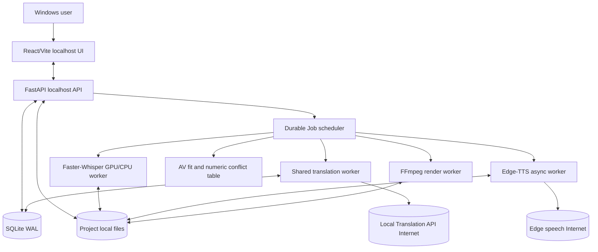
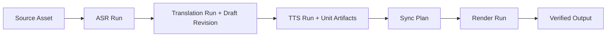

# 02 — System Architecture & Technology Choices

> **Phase rule:** `14_SCOPE_BASELINE.md` defines mandatory MVP vs V1/V2 scope; advanced designs in this document do not imply MVP implementation.

**Status:** Architecture reference; implementation slices and owner acceptance are tracked in `TASK.md`. TRANS-03A removed Local Translation execution; new translation remains unavailable pending LOCAL-01A.

## 1. Context diagram



## 2. Top-level components

| Layer | Target technology | Responsibility | Rationale |
|---|---|---|---|
| Presentation | React 19 / TypeScript / Vite, router, TanStack Query or equivalent | Project Library, editors, controls, progress | Better rich interaction than legacy Streamlit full reruns |
| Local API | Python 3.11 **candidate**, FastAPI/Pydantic v2 | Typed HTTP endpoints, range media streaming, input validation | Mature async API and Python media ecosystem |
| Work coordinator | Separate Python worker processes, SQLite job tables | Minimal single-host durable status, progress, cancel/retry/recover in MVP; advanced lease/heartbeat only V1 if needed | Heavy inference isolated from HTTP thread |
| Persistent metadata | SQLite WAL, schema migrations via Alembic or explicit SQL | Project, Run, Unit, artifact, Job, edit revisions | Single-user local persistence, transactional updates |
| Media | FFmpeg/FFprobe CLI, `soundfile`, optional `PyAV` | Decode/extract, combine, measure, render | Avoid handling full video frames in Python |
| ASR | Faster-Whisper / CTranslate2 | Speech segments with start/end | GPU float16 or CPU int8 fallback |
| Translation | Local Translation engine + `google-genai` adapter | Local Translation `gemini-3.1-flash-lite` only | One prompt/chunk/mapping/persistence path; provider/model/adapter snapshot per Run |
| Speech | `edge-tts` as default adapter | Vietnamese voice TTS, MP3/format metadata | Match legacy user preference; requires internet |
| Voice preview | Bounded file cache | Short sample by exact voice/rate/pitch/config | Avoid repeated network generation |
| Subtitle OCR (optional) | OpenCV + EasyOCR/other measured implementation | Suggest old subtitle location | Costly stage, opt-in, verify visually |
| Hardware probe | OS queries, `nvidia-smi` when present, FFmpeg capability enumeration | Choose safe profile | Actual supported hardware rather than assumptions |
| Packaging | `run.cmd` for development, future frozen installer | One-click Windows launcher | Avoid uncontrolled services |

**Version rule:** The versions above are candidates or families; resolve exact compatible pins with a clean environment during ARCH-00. Faster-Whisper/CTranslate2 GPU dependency requires testing against actual CUDA/cuDNN/driver. No claim that a user NVIDIA GPU exists.

## 3. Directory structure — proposed source repository

```text
AutoDub-Local/
├── README.md  AGENTS.md  RULES.md  PLAN.md  TASK.md
├── CHANGELOG.md  UPDATES.md  ERROR_LOG.md
├── .env.example  .gitignore  run.cmd
├── frontend/
│   ├── package.json  src/
│   ├── src/app/  src/pages/  src/components/
│   ├── src/features/projects/
│   ├── src/features/asr/
│   ├── src/features/translations/
│   ├── src/features/tts/
│   ├── src/features/sync-table/  # MVP; full timeline deferred to V2
│   ├── src/features/render/
│   └── src/api/  src/types/
├── backend/
│   ├── pyproject.toml  requirements.lock
│   ├── app/main.py
│   ├── app/api/routes/
│   ├── app/core/config.py  app/core/hardware.py
│   ├── app/domain/{project,segment,translation,artifact,job}.py
│   ├── app/repositories/{project,unit,job,artifact}.py
│   ├── app/storage/{paths,media,backup}.py
│   ├── app/services/{asr,translation,tts,sync,render}/
│   ├── app/providers/tts/{base,edge}.py
│   ├── app/workers/{runner,asr,translation,tts,render}.py
│   ├── app/db/migrations/
│   └── tests/{unit,integration,fixtures}/
├── scripts/{launcher,diagnostics,benchmarks}/
└── docs/
```

`data_root` is *outside the source repo*. Never ship media, API keys, AI models, venv or cached WAV in Git.

## 4. Processing boundary / no oversized pipeline controller

Each stage consumes immutable snapshots and emits verified artifacts. Orchestration does **not** call every stage within one HTTP request. API schedules a durable Job and returns `202` + Job ID. A worker reports progress. UI polls or uses SSE/WebSocket; polling is acceptable for MVP. Each result can be edited, accepted and rerun independently.



Edits invalidate only descendants whose *actual input fingerprint* changes. Example: correcting a source Segment invalidates dependent translation units; a translation edit invalidates dependent TTS units and sync/render. Changing subtitle color invalidates render only.

## 5. Eventing & ownership

- API owns business validation and local user actions; worker owns long job and artifact publication.
- Only one active high-VRAM ASR/OCR job by default; renderer may be GPU-exclusive depending on device budget; Edge TTS is network-bound with bounded concurrency.
- MVP uses a single-machine owner/supervisor, persisted JobAttempt and safe startup reconciliation; lease/heartbeat is an optional V1 enhancement if validated multi-worker requirements emerge.
- UI never infers Job success from existence of an `.mp3` file alone. Database READY is published after FFprobe/decoder verification and integrity checks.

## 6. Storage-independent provider contracts

- `SpeechProvider.list_voices()`, `preview(config)`, `synthesize(unit_id, text, config, output_path, cancel_token)` returns validated artifact metadata.
- `TranslationProvider.translate(groups, context, config)` returns schema-validated mappings with token usage and model/version.
- `MediaProbe.probe(path)` returns stable technical metadata; `RenderEngine.render(plan)` returns verified manifest.
- Never pass secrets into frontend; API may return *capability descriptions*, not credentials.

## 7. Hardware truthfulness

- `h264_nvenc` uses GPU encoder; CPU-based `subtitles`/`libass` filter may require `hwdownload`/`hwupload`, so not every step is on GPU.
- CUDA decode and GPU scaling only when the exact FFmpeg build/filter chain permits it; GPU–CPU transfers may slow things down.
- Faster-Whisper GPU float16 often faster, but on low VRAM the CPU path can be more reliable. Benchmark on target PC, record config.

## 8. Trust boundaries

Local UI on `127.0.0.1`, backend on `127.0.0.1`, Windows filesystem trusted only after user selection, and external Local Translation/Edge endpoints remain separate consented boundaries. Translation consent is Local Translation-specific; historical provider provenance remains readable. Validate files based on probing, not extension alone. Rate-limit local endpoints and ensure no remote web page can invoke destructive local APIs through weak CORS/CSRF protections.
