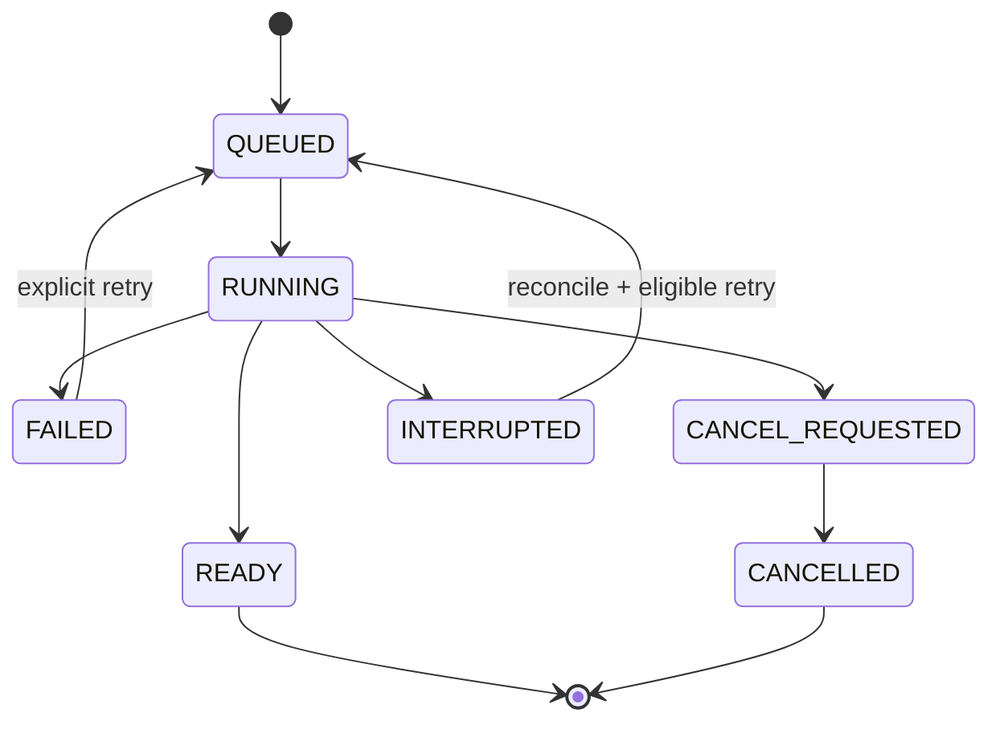

# 07 — Local API, Durable Jobs & Recovery Contracts

> **Phase rule:** `14_SCOPE_BASELINE.md` defines mandatory MVP vs V1/V2 scope; advanced designs in this document do not imply MVP implementation.

## 1. API goals

FastAPI on `http://127.0.0.1:8000/api/v1`, strictly local. Responses JSON validated by Pydantic; human-readable Vietnamese errors with machine-readable stable code; long tasks queued with Job ID and `202 Accepted`. No Supabase and no remote HTTP for media storage.

## 2. Proposed API endpoints (design, not implemented)

| Method | Path | Purpose |
|---|---|---|
| `GET` | `/health` | Backend, DB, worker readiness, no secrets |
| `GET` | `/hardware/capabilities` | CPU/RAM/GPU, ASR device and FFmpeg encoder probes |
| `GET/PATCH` | `/settings` | User roots, resource profile, optional configuration |
| `POST` | `/dialogs/source-file` | Trusted Windows local picker, if implemented; no browser arbitrary path |
| `POST` | `/dialogs/output-folder` | Select output destination in local-only trusted interaction |
| `POST` | `/projects` | New Project |
| `GET` | `/projects` | Paginated Project Library |
| `GET/PATCH/DELETE` | `/projects/{id}` | Details, rename, safe delete with confirmation |
| `POST` | `/projects/{id}/media/import` | Copy/link selected source; validate and probe |
| `POST` | `/projects/{id}/media/relink` | User-authorized relink; hash/metadata verify |
| `GET` | `/projects/{id}/media/{asset_id}/stream` | Range-supported playback, no generic path parameter |
| `POST` | `/projects/{id}/asr/jobs` | Start ASR snapshot Job |
| `GET/PATCH` | `/projects/{id}/asr/runs/{run_id}` | List and review transcript |
| `POST` | `/projects/{id}/translations/jobs` | Start Gemini translation |
| `PATCH` | `/projects/{id}/translations/runs/{run_id}/units` | Bulk optimistic edits |
| `GET` | `/projects/{id}/translations/runs/{run_id}/editor` | Read immutable provider output, draft and active accepted revision |
| `POST` | `/projects/{id}/translations/runs/{run_id}/drafts` | Create/reuse a draft from provider output or active accepted revision |
| `PATCH` | `/projects/{id}/translations/runs/{run_id}/drafts/{revision_id}/units` | Atomic bulk edit with expected lock version and idempotency key |
| `POST` | `/projects/{id}/translations/runs/{run_id}/drafts/{revision_id}/accept` | CAS-accept immutable draft revision |
| `POST` | `/projects/{id}/translations/runs/{run_id}/accept-original` | Accept immutable provider output as a revision |
| `GET` | `/tts/voices?provider=edge` | Current voice options (cacheable) |
| `POST` | `/tts/previews` | Cached sample by config |
| `POST` | `/projects/{id}/tts/jobs` | Generate selected/all stale Units |
| `GET` | `/projects/{id}/tts/units/{unit_id}/audio` | Local artifact stream after active-revision check |
| `POST` | `/projects/{id}/sync/plans` | Compute conflict plan |
| `PATCH` | `/projects/{id}/sync/plans/{plan_id}` | Save manual decisions |
| `POST` | `/projects/{id}/renders/jobs` | Preview range/full render |
| `GET` | `/projects/{id}/renders/{render_id}` | Output metadata, validation |
| `GET` | `/jobs/{job_id}` | Status, phases, timestamps, metrics |
| `POST` | `/jobs/{job_id}/cancel` | Cooperative + process-tree cancellation |
| `POST` | `/jobs/{job_id}/retry` | Idempotent retry if eligible |
| `GET` | `/jobs/events` | SSE stream, optional fallback polling |
| `POST` | `/projects/{id}/backup` | V1-only Project backup Job (not required in MVP) |
| `POST` | `/projects/import-backup` | V1-only restore after validation (not required in MVP) |
| `POST` | `/storage/cleanup/preview` | Dry-run reclaimable inventory |
| `POST` | `/storage/cleanup/execute` | Confirmed scoped cleanup only |

## 3. API payload sketches

The translation editor routes above are implemented in the TRANS-01B slice. Mutations require the existing local session, exact Host/Origin and CSRF guards, plus an `Idempotency-Key`; bulk save includes `expected_lock_version` and the complete edit list. Stale locks or active-revision races return a conflict; invalid/duplicate/unknown Unit IDs reject the whole transaction. Drafts are mutable only through bulk save. Provider output and accepted revisions are immutable. The editor GET is read-only and returns source Units, current draft (if any), and active accepted revision separately. This does not implement a TTS endpoint or mark G4 accepted.

Translation Run responses include an immutable `pass_strategy` (`SINGLE_PASS` for new production Runs, `TWO_PASS` for existing Runs) and Unit `final_text`. Single-Pass results leave `pass1_text` and `pass2_text` null; clients render `final_text` and must not infer a second generation. The create request continues to require `privacy_consent_confirmed: true`; local UI remembers consent but sends that assertion on each Job creation request.

```json
{
  "job_id": "uuid",
  "status": "queued",
  "kind": "tts_generate",
  "project_id": "uuid",
  "input_fingerprint": "sha256-hex",
  "requested_units": ["unit-uuid"],
  "config_snapshot": {"provider":"edge", "voice":"vi-VN-NamMinhNeural", "rate_percent":0}
}
```

```json
{
  "error": {
    "code": "translation_revision_conflict",
    "message": "Bản dịch đã thay đổi. Vui lòng tải lại để đối chiếu.",
    "retryable": false,
    "details": {"unit_id": "uuid"}
  }
}
```

Pseudocode only; actual schema is versioned, identifiers are valid UUIDs, no arbitrary directory path in media stream endpoints.

## 4. State machines



`Job.status` separate from `Artifact.status` and `Run.status`. A TTS Job can still run while individual Unit artifacts are READY. Translation draft can be REVIEW_REQUIRED while ASR Run remains READY.

## 5. SQLite Job claim — MVP simple owner; lease/heartbeat as V1 enhancement

A dedicated scheduler claims using a short write transaction. Example:

```sql
BEGIN IMMEDIATE;
-- SELECT top eligible job with status queued, priority and resource policy;
-- UPDATE jobs SET status='running', owner_process=?, attempt_count=... WHERE id=? AND status='queued'; -- MVP only
-- INSERT job_attempts(...);
COMMIT;
```

Do not hold a DB transaction during model inference, Gemini/Edge network or FFmpeg. MVP: a single supervised local worker owns active Jobs; on restart reconcile interrupted process/Job state and validate staged artifacts before resume/retry. Advanced lease-token heartbeats are V1 only if multiple claimers are introduced; never re-run already READY matching Units unnecessarily.

## 6. Concurrency

- Resource scheduler restricts heavy GPU/CPU/disk tasks; network Edge TTS limited and fair.
- Duplicate request: idempotency key and input fingerprint; existing running job returned instead of launching duplicates.
- Cancel: flag in DB, event to worker, terminate child process tree if unresponsive after grace period; failed cancels remain explicit.
- Error handling: transient retry with jitter; permanent invalid input/key/quota/corrupted source -> FAILED/REVIEW_REQUIRED.

## 7. Media streaming details

Use secure `GET .../stream`, `206 Partial Content`, correct `Content-Range`, MIME from FFprobe/media whitelist, `Accept-Ranges`, reasonable cache validator. Never expose generic absolute `?path=` endpoint or open unrestricted file; check Project membership and local loopback origin. Handle media while writer still producing via immutable versioned files only.

## 8. Client interaction

TanStack Query refreshes safe read endpoints; SSE or polling for progress. UI uses request generations to ignore late responses. Dirty edits persist in local UI until explicit Save All; on revision conflict show diff/resolve, don't discard local draft.

## 9. Observability

JSONL Job logs with `job_id`, attempt, timestamp UTC, stage, duration, device, sanitized error code; secret/media text omitted. Metrics time to first preview, time to first unit READY, total runtime, rendering fps and optional GPU utilization. Separate cold vs warm; no invented percent progress for Gemini/Edge latency.
