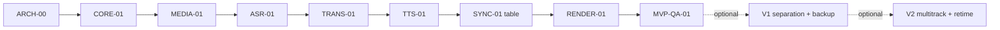

# 08 — Practical Implementation Roadmap & Acceptance Gates

**State:** Design proposal. **Scope authority:** `docs/14_SCOPE_BASELINE.md`. No implementation or acceptance evidence exists yet. One focused Codex prompt per implementation slice; no mega-prompt.

## Dependency chain

## Gate G0 — ARCH-00: Repository and contracts

Create React/TS + FastAPI skeleton, CI-ready test commands, Windows launcher design, storage and Run fingerprints, schema and API contracts. Confirm Edge-TTS voice selection, source-copy vs source-link behavior, file ownership, API privacy and hardware detection criteria. **Gate:** owner accepts MVP boundaries before writing major features.

## Gate G1 — CORE-01: Local persistence

SQLite schema and migrations, WAL, minimal durable Job/Attempt progress/cancel, atomic file publishing, startup reconciliation after unexpected process exit. Use one local worker owner per active resource; no distributed-style lease/heartbeat system until concrete concurrency demands it. **Gate:** restart and aborted operation do not produce false READY or lost saved edits.

## Gate G2 — MEDIA-01: Source intake

Project Library, user folder choice, Copy/Link, FFprobe, safe HTTP Range playback, missing-source relink, Unicode path support. **Gate:** real video can be selected/played without remote upload.

## Gate G3 — ASR-01: Speech recognition

FFmpeg extraction, Faster-Whisper model/language/VAD settings, measured CUDA/CPU fallback, immutable transcript and editor. **Gate:** transcript+timing reviewed for real sample including no-audio/quiet case.

## Gate G4 — TRANS-01: Context translation

Gemini two-pass with controlled chunks and complete source mapping; editable structured Unit rows; Save All; no trailing punctuation forced per fragment, no silent omission. **Gate:** full mapping and manual revisions survive restart; provider failures actionable.

## Gate G5 — TTS-01: Edge narration

Voice/rate/pitch settings, preview, bounded concurrency, per-Unit WAV/MP3 artifact, immediate play of completed Units, selective regeneration using fingerprint, no fake audio, timeout diagnostics. **Gate:** 50-Unit mixed outcomes, retry, cancel and consistent playback verified.

## Gate G6 — SYNC-01: Simple numeric table

Compute overlap/overflow against fixed source timeline, propose bounded rate/gap/offset changes, show conflict table and allow manual edit/seek. **No video stretch, no multitrack visual editor.** **Gate:** measured audio and planned positions agree with immutable sync plan; conflicts cannot be hidden.

## Gate G7 — RENDER-01: Local MP4

FFmpeg plan compiler for baseline dubbing, source mute/gain/ducking, narration mix, optional subtitles, resolution/codec/settings, hardware encoder capability probing. Render temporary → verify FFprobe/decode → publish immutable MP4. Add short-range preview after core rendering path passes. **Gate:** real portrait and landscape MP4, failures leave previous output intact.

## Gate G8 — MVP-QA-01: User end-to-end acceptance

Run and review complete input → final video, mid-stage edits, stale invalidation, interrupt and reopen, local file handling and essential resource fallback on real Windows. **Gate:** user acceptance recorded separately from automated tests.

## V1 — Quality, optional separation, reliability

- `V1-SEP-01`: evaluate Demucs or other fit-for-dialogue separation model on real voices + music/SFX. Measure listening quality, remaining voice leakage, CPU/GPU use; compare to mute/ducking. Don't promise clean stems by default.
- `V1-OPS-01`: consistent Project backup/restore package, SHA-256 manifest and tested restore to another folder.
- `V1-OPS-02`: larger batch queue, durable interruption management, selective lease/heartbeat if needed, performance profiling and richer diagnostics.

## V2 — Advanced editing and video retiming

- `V2-TIMELINE-01`: multitrack UI, waveform, drag/resize/undo, virtualized clips and performance tests.
- `V2-RETIME-01`: stretch/retime selected source region only with canonical piecewise time map applied to all audio/subtitle/video events and downstream durations; require long/VFR drift tests before inclusion.

## Stage acceptance report contract

Every gate records: files changed, measured outcome, PASS/FAIL/NOT RUN/BLOCKED for tests, actual hardware path, bugs/risks, documents updated, and explicit pending user approval. Do not mark a later-stage feature as delivered because its interface was scaffolded.
